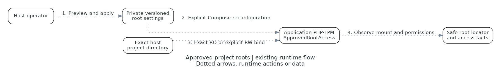

# Approve a local project root

No host project roots are exposed by default. Select the installation first: run these commands inside the
main checkout or the specific registered worktree. The operation affects only that installation. Do not
select an entire home, a shared parent, a directory containing private installation data, or any tree that
contains data the application should not see. Approval covers the whole selected tree, not just tracked Git
files. Read-only is the default; `--access rw` gives the application process physical write access to the tree.
No operation here writes to a project, grants Project or Agent authority, or provides a browser mount editor.

## Preview, apply and verify

```sh
./bin/runtime roots status
./bin/runtime roots add example /absolute/canonical/project
./bin/runtime roots add example /absolute/canonical/project --apply PREVIEW_DIGEST
# Linked checkout: use the exact registered path. Main: use ./bin/up, preserving its existing ingress mode.
./bin/up --worktree /absolute/registered/checkout
./bin/runtime roots status
```

Use the digest from the immediately preceding preview. `change NAME PATH [--access ro|rw]` replaces that
approval; repeat `--access rw` to retain an existing write grant. `remove NAME` withdraws exposure; it never
removes source. Both commands use the same preview-then-apply sequence. A stale preview or changed root is
refused. Do not concurrently move, replace or remount the selected directories, edit the private settings file,
or run other runtime reconfiguration while applying changes. Compose binds paths, not held directory handles;
revalidation is not isolation from a concurrent host owner or a modified Docker daemon.

Apply changes configuration only. A running service keeps its old mount until recreation. A removed or
replaced root may still be physically exposed if `status` reports a nonzero `stale_mounts` count. Reconfigure
promptly. To end exposure immediately without recreating the runtime, run
`./bin/runtime docker compose stop https_php` in the selected checkout. Task `down` also stops FPM but disposes
its database and storage as documented in the [resource procedure](RESOURCE_LIFECYCLE.md).
To recover, preview and apply the inverse operation with the previous approved path/mode, reconfigure, and
inspect status again. If the previous path is gone or its identity changed, do not silently restore it. Restore
only a known private backup of corrupt settings while the installation is stopped. Never use `chmod` or `sudo`
to make a selected directory pass. If the service runs as a different owner, OS access can remain unavailable.

## Boundaries and observations

- Settings are versioned, owner-only and ignored: `var/runtime/approved-roots/roots.json` for main;
  `var/worktrees/<project>/approved-roots/roots.json` in the canonical checkout for a worktree. A validated
  Compose fragment declares only exact roots and one dedicated read-only configuration directory. No root
  binds go to the gateway, database, storage, mail, tooling or Runner. Do not mount the installation's
  private state or copy this file to tickets; it contains host paths, not credentials.
- Only the selected local Unix Docker context is supported. Host policy admits fixed internal APFS on macOS
  and ext4/XFS on direct fixed PCI NVMe or ATA storage on Linux; Linux requires separate platform qualification. Network, removable,
  virtual/stacked Linux filesystems and roots with nested host mounts are rejected. Use canonical names made of
  ASCII letters, digits, spaces, `.`, `_` and `-`. Symlink components, aliases, traversal, complete homes,
  inaccessible directories, filesystem boundaries under a selected root and overlapping approvals are refused.
- Host status compares the desired roots with the selected FPM container's actual bind declarations and the
  application's mount and permission observations. The read-only application capability exposes only an
  operator-chosen `root:NAME`, configured/mounted/readable, write grant/writability and safe reasons. It does
  not enumerate a directory or prove arbitrary descendants are usable. A later checkout operation must still
  resolve and authorize its own contained path. The authenticated browser query and its permission belong to
  [TASK-00074](../../planning/tasks/00074-TASK.md); this task adds no browser route.

## Runtime flow



[Editable diagram](approved-roots/runtime-flow.py). This view describes the implementation beside this image,
not later browser permissions, descendant access, or Runner isolation.

| Step | Source |
|---|---|
| 1. Preview and apply | [`operate`](../../scripts/resource_lifecycle/approved_roots.py) validates an explicit approval and saves settings |
| 2–3. Reconfigure | [`compose`](../../scripts/resource_lifecycle/preparation.py) loads the exact FPM-only binds |
| 4. Observe | [`ApprovedRootAccess::observe`](../../src/Adapter/Installation/ApprovedRootAccess.php) reports safe facts from configuration and mount metadata |
