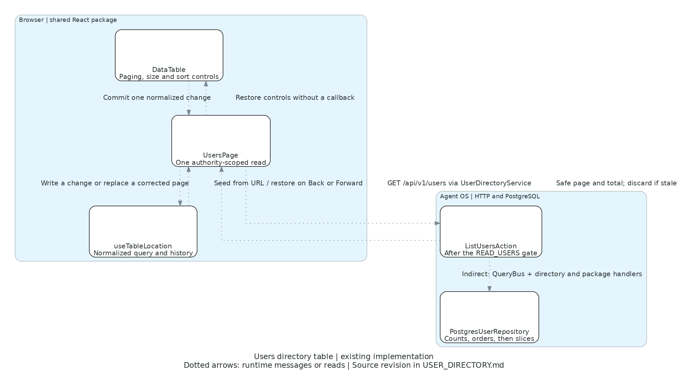
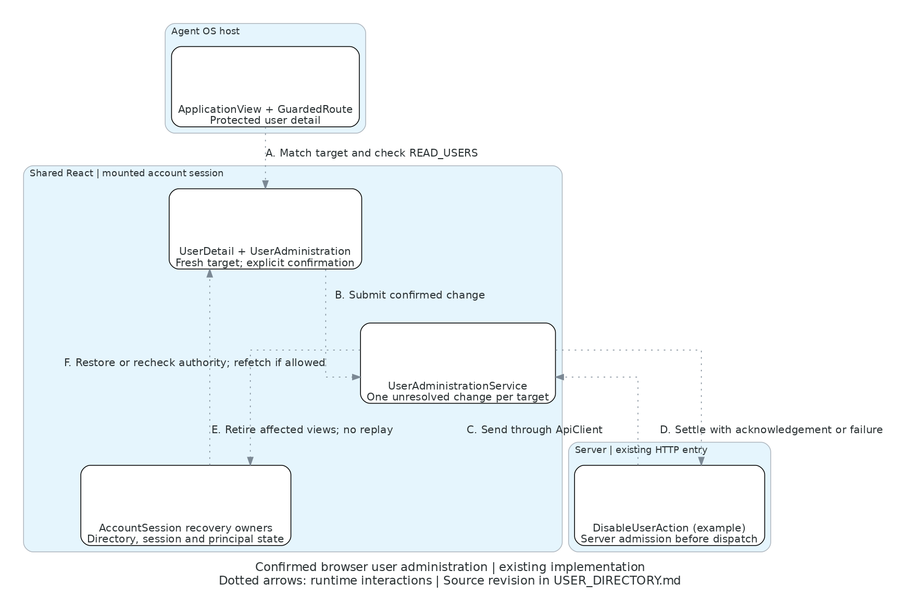

# Permission-controlled user directory

TASK-00059 implements `GET /api/v1/users` and the browser directory, now at `/admin/users`. Local implementation evidence is in the
TASK; independent Review/QA and delivery remain separate.

## Authority and ownership

Each matched user Action declares `#[RequiresPermission('READ_USERS')]` once. Existing `ApiActionSecurity`
enforces Bearer authentication and exact current `READ_USERS` through the authoritative request-scoped
principal provider before Action execution, validation or package dispatch. Neither Action repeats permission
or installation-policy enforcement. The directory dispatches package `ListUsers` on the configured shared
QueryBus. This is the owner's TASK-00118 single-declaration correction; no consumer read wrapper remains. Missing, stale, incomplete or
non-active authority fails closed. A displayed `ROLE_SUPER_ADMIN`, JWT/HTML claim, submitted actor or client
route never grants a read. No new identity, principal, session or authorization store is introduced.

Fight Access Control owns identity pagination and safe `UserView` production. The existing PostgreSQL user
repository defaults to `created_at ASC, id ASC`. It applies allowlisted ordering to the full dataset before
paging. Creation time uses ascending ID for ties. The Action
uses the registered `ListDirectoryUsers` query. Its handler fetches the canonical `ListUsers` page and
calls `GetRoleById` for each unique assigned Role. It returns a typed page of joined User and Role Views;
the Responder maps those Views into HTTP data without a lookup. Missing,
unexpected or duplicate returned references, duplicate assignments/identities or duplicate resolved names
fail the whole response with a sanitized system failure, not an incomplete role list. Each user's assignments
are sorted by exact role name. An empty assignment remains empty; it does not imply `ROLE_USER`.

## HTTP contract

- Optional validated query fields: `page` **1–1000**, `per_page` **1–100**, `sort` **ID or Created**, and
  `order` **asc or desc**. Defaults are **1**, **25**, **Created**, and **asc**. The same controls apply to the
  Role and Permission list APIs, with their own READ admission.
  Checked decimal-digit strings are explicitly converted to package pagination integers. Leading zeroes and
  valid percent-encoded names/values are accepted; empty, signed, fractional, ambiguous, duplicate decoded,
  nested, unknown or malformed fields are rejected before the Action/query. A GET body is rejected, not merged.
- Includes installation-wide **pending_activation, active, disabled and deleted** identities. No query can
  select actor, authority, workspace, role, relations, hidden fields or visibility. There is no search, filter,
  free-form ordering or mutation. The client does not filter one partial page as though it were the installation.
- Offset pages are deterministic for a committed state, **not** a transactionally consistent cross-request
  snapshot. Concurrent writes can shift rows and counts. The browser replaces an out-of-range page once and
  offers a reload if counts continue shrinking. It never extrapolates unseen identities. Page 1000 is the last navigable page even if the count implies more.
- Success is JSend `{status: "success", data: {page, per_page, total_pages, total_records, records}}`.
  Empty results have at least one total page; out-of-range pages can have no records.
- Every record has exactly `user_id`, canonical `email`, `state`, `roles`, `created_at`, `updated_at`.
  A role has exactly `name` and boolean `managed`. The marker describes ownership, not editability or authority.
  Timestamps are UTC ISO-8601 at second precision; persistence's finer ordering precision is not exposed.
- All responses use the shared **`Cache-Control: no-store`** policy; successful reads set no cookies. `401` is
  authentication failure, `403` is current permission failure, `400` is sanitized input rejection and `500` is
  generic unavailable state. Correlation is metadata, not a source of authority.
- No password/hash, session/refresh material, grant/digest/ciphertext/link, authentication/authorization revision,
  pending email/reservation, permission membership/snapshot, audit/delivery/provider internals or entity is
  serialized. Explicit `UserDirectoryData` maps only approved fields; it never delegates entity serialization.
  Attribute-owned OpenAPI documents the actual read and closed schemas; exports stay private under `var/`.

## Browser behavior and invitation handoffs

`UserDirectoryService` uses the existing same-origin, current-memory Bearer API transport and strict exact-key
codecs. Email syntax/admission belongs to the server/package: the client preserves bounded, nonempty,
lowercase, control-free canonical display text verbatim, including quoted local parts containing `@`, rather
than applying a second email grammar. Lifecycle must be one of the four documented strings; arrays and other
coercible values are protocol failures. Its only retained state is a safe refusal category to prevent a guard
remount from replaying a denied read. `UsersPage` owns one volatile page and an AuthorityCache scope: authority retirement, context replacement,
unmount and page changes abort/fence pending work and remove private rows. `401` uses the sole bounded session
restoration owner; `403` revalidates current authority. Neither automatically replays the refused operation;
recovery needs explicit Retry. The shared table owns interactions. UsersPage writes canonical `page`,
`per_page`, `sort`, and `order` to the URL and restores from reload and Back/Forward. Unsupported search and
filter options are dropped and never forwarded. Clicking the current Users link keeps the URL and page unchanged.
A copied link opened while signed out retains only these four normalized options in the one-shot in-memory
intent. It drops host parameters and the fragment across sign-in, then restores the options only after fresh
`READ_USERS` admission. History stores no user rows, identities, or credentials.

The single production route manifest independently guards every destination, and shared `evaluateAccess`
controls presentation and link activation:

| Control | Exact current permissions | Registered destination |
|---|---|---|
| Directory | `READ_USERS` | `/admin/users` |
| Invite User | `INVITE_USERS` | `/admin/invite` |
| Invite Super Admin | `INVITE_USERS` **and** `ASSIGN_SUPER_ADMIN` | `/admin/invite-super-admin` |
| Pending row's Invitation status | `READ_USERS`; target must be pending | `/admin/invitations/{user_id}` |

TASK-00060 implements the target status route using a classified UUID path, never email, form input or credentials in URLs/history. READ_USERS-only viewers have read-only status; page changes additionally require MANAGE_USER_INVITATIONS, which grants no read authority (explicit human correction, 2026-11-02). Ordinary/elevated invitation forms remain unavailable under TASK-00061/00062. Recovery invalidates local directory/detail generations: mounted lists refetch, mounted detail retracts its data and requires deliberate Reload, and returning pages read fresh. Pending invitation reads now use this safe detail API plus the separately protected delivery GET; mutation acknowledgements contain no data. No invitation API is duplicated and no link sends mail.
Forbidden controls are absent, not hidden focus targets. Client presentation never replaces server enforcement.

### Table read and restoration flow

Existing implementation at `b7d458ec98e76b26d9710d8d54552635704a23bd`.
[Editable Python](shared-react/users-table-flow.py). Dotted arrows show runtime messages or reads, not static dependencies.

| Flow | Source trace |
|---|---|
| Commit one change; restore without another callback | [`DataTable`](../../packages/react/src/components/DataTable.tsx) emits `onChange` from `commit`; it takes external state from `restore.revision`. [`UsersPage`](../../packages/react/src/pages/UsersPage.tsx) wires the two directions. |
| Seed/restore from the address; write a change or replace a correction | [`useTableLocation`](../../packages/react/src/components/useTableLocation.ts) reads the initial URL and `popstate`, pushes table gestures, and replaces a corrected page from `restoreQuery`. [`UsersPage`](../../packages/react/src/pages/UsersPage.tsx) checks the total before requesting a correction. |
| Request the current authorized page and publish only while current | [`UsersPage`](../../packages/react/src/pages/UsersPage.tsx) fences by query, abort signal and live scope. [`UserDirectoryService.load`](../../packages/react/src/features/users/UserDirectoryService.ts) uses the same-origin API client. [`ListUsersAction.handle`](../../src/Adapter/Http/Action/Api/V1/Users/ListUsersAction.php) declares `READ_USERS` and returns a safe page. |
| Fetch the ordered page, then read its total separately | The Action dispatches through the query bus to the [registered directory handler](../../config/application/user_directory.php), which [calls package user and role reads](../../src/Application/AccessControl/User/QueryHandler/ListDirectoryUsersHandler.php). [`PostgresUserRepository::getAll`](../../src/Adapter/Persistence/AccessControl/User/PostgresUserRepository.php) applies `CatalogOrdering` before offset and limit, fetches the page, then runs the separate `COUNT(*)` query. |

The host also restores explicit Users destinations through `useTableLocation`. It normalizes the Users options
and preserves unrelated destination parameters in the address, not in list requests. The sign-in intent instead
keeps only the canonical Users options and a yes/no reset flag. A malformed destination that resolves to the
current address shows the notice without adding a history entry or making another list request.

This source view compresses bus and mapping steps. It omits programmatic navigation, sign-in, detail,
Role/Permission endpoints, and the example consumer's search. It does not certify runtime behavior, accessibility, or independent acceptance.

## Safe user detail (TASK-00118 implementation)

`GET /api/v1/users/{userId}` uses a matched FQCN Action whose single `READ_USERS` metadata declaration
is enforced by the same central request gate before execution. It dispatches existing package `GetUserById`
and referenced `GetRoleById` queries through injected QueryBus. Self-service permissions and ownership
never authorize this route. Missing/stale authority fails before target dispatch; an authorized missing target
returns generic 404. Malformed UUIDs, query fields and GET bodies are sanitized 400s. All outcomes are no-store.

Success is `{status: "success", data: <DirectoryUser>}` with exactly the directory's six safe fields.
`UserRoleData` maps complete already-fetched package Views into deterministic endpoint role data for both
Responders; `UserData` owns their single HTTP field allowlist. Neither mapper fetches data or decides authority. No credential, permission membership, audit, revision or pending-email fields are
added. Missing, duplicate, unexpected or aliased role references fail the entire response. Lifecycle remains
one of the same four package states. Reads observe current committed data, not an atomic cross-request snapshot;
a target disappearing after the gate returns 404. Each new request resolves authority anew at the gate;
there is no second Action recheck or atomic authorization-and-read guarantee.

Each directory row has a permission-rechecked **View details** button. Selection clears the list and fetches
fresh detail; it does not reuse the row as current target state. TASK-00123 adds a protected host route at
`/admin/users/{user_id}` so detail can read again after authority changes. The route carries a classified UUID and
bounded table options, never email, a session ID, a reason or credentials. Back refetches the same bounded page.
Authority retirement clears private data and fences outstanding work. The existing 401/403 refusal fence and
session/principal owners still control detail recovery. The shared component also supports hosts that keep
selection in memory. Lifecycle, role and cross-user session actions use existing, separately protected APIs.

Qualified installed Fight Access Control **v0.8.0**, source/Composer lock reference
`319738255e682d587642b67856039f882b9588d6`: `GetUserById(UserId)` dispatches through the configured bus,
returns nullable safe `UserView`, and does not authorize public callers. The consumer enforces permission,
checks returned identity/type and explicitly maps role references rather than serializing `UserView::toArray()`.
`GetRoleById(RoleId)` returns nullable `RoleView` with public ID/name/managed accessors; it needs no permission
membership or revision in the wire output. The package does not promise a combined user-plus-role snapshot;
missing references fail the whole endpoint. No dependency upgrade or parallel handler graph is introduced.
The removed `ReadUserDetail`, `ReadUserDirectory` and repository-backed `UserRolePresentation` have no surviving
callers. Independent acceptance and browser QA remain separate from Work's local checks.

## Confirmed user administration flow

Existing implementation at `ea9dd583a874b50341f5906919449b913513aab1`.
[Editable Python](shared-react/user-administration-flow.py). Arrows show runtime interactions, not static dependencies.

| Flow | Source trace |
|---|---|
| A. Match and guard detail | [`matchApplicationRoute`](../../client/src/routes/applicationRoutes.ts) classifies the target; [`ApplicationView`](../../client/src/routes/ApplicationJourney.tsx) mounts the shared Users page inside [`GuardedRoute`](../../client/src/routes/GuardedRoute.tsx). [`UserDetail`](../../packages/react/src/pages/UserDetail.tsx) reads fresh detail rather than using list data. |
| B–C. Confirm and send | [`UserAdministration`](../../packages/react/src/features/users/UserAdministration.tsx) offers only applicable actions and asks for confirmation. [`UserAdministrationService.change`](../../packages/react/src/features/users/UserAdministrationService.ts) checks current client scope and owns the outstanding write through [`ApiClient.mutate`](../../packages/react/src/api/ApiClient.ts). |
| D. Respond after existing server admission | [`DisableUserAction`](../../src/Adapter/Http/Action/Api/V1/Users/DisableUserAction.php) is the example entry. It declares its permissions and dispatches only after server admission; the browser interprets the acknowledgement without applying an optimistic state. |
| E–F. Retire and reread | [`createAccountSession`](../../packages/react/src/features/auth/AccountSession.ts) retires affected views and uses the existing session/principal owners. A submitted change stays pending until transport settles, even across detail remounts. A retired scope does not receive the old notice. The current route reads again only under verified access. |

A role catalog or admin session read rejected with 401 or 403 also retires old authority. The browser
restores the session on 401 or rechecks the principal on 403. It does not replay the rejected read on
remount; when access remains, the section's Reload button requests it explicitly. The diagram omits that
read-recovery path, endpoint inventory, bus/transaction internals and invitation/owned-session flows.
A transport failure is not proof that the server rejected the write. The browser does not automatically
retry it. This diagram is a source trace, not live or accessibility evidence.

## Responsive and verification boundaries

One captioned table has scoped headers and keyboard-accessible horizontal scrolling when it is wider than
its container. Controls wrap independently; there is no second data tree or mobile loader. Long email and role
labels wrap. Text lifecycle labels and managed/
custom markers do not depend on color. Native links/buttons, at least 44px controls, explicit loading/empty/
forbidden/system states, polite page-count announcements and post-pagination/retry heading focus use the
existing frame, themes, fonts, focus and reduced-motion rules. Pagination clears previous-page rows while
loading and offers First page after navigation.

Owned tests exercise exact permission subsets, no-dispatch rejections, stale authority at the central gate, PostgreSQL ties
and lifecycle visibility, complete role resolution, safe Views/OpenAPI, strict client decoding, cancellation,
volatile retirement, registered destinations, keyboard recovery and semantics. Twelve production-backed Users
stories cover ready/dark/narrow/long-email/loading/empty/system/server-forbidden/role-name-denied/read-only/
pagination/retirement states. Catalog authority/data are synthetic fixtures, not authentication E2E proof.
Actual browser axe/reflow/focus samples and isolated live probes are recorded separately in TASK evidence.
Automation and sampled observations do not establish universal WCAG conformance, physical device or screen-reader
certification. The fresh canonical `./bin/build`, independent Review and applicable QA remain mandatory.
