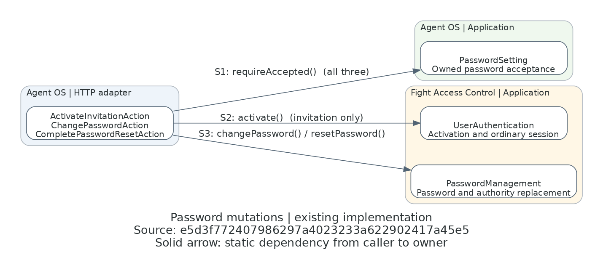

# Password mutation ownership

[Editable Python source](password-mutation-ownership.py). Existing implementation at
`e5d3f772407986297a4023233a622902417a45e5`. The HTTP entries now call the password policy and the
package owners directly. They classify deliberate refusal separately from unconfirmed or internal failure;
they no longer go through three forwarding services.

| Arrow | Source at the revision above | What the source shows |
| --- | --- | --- |
| S1 | [Activation](../../../src/Adapter/Http/Action/Api/V1/Auth/ActivateInvitationAction.php), [change](../../../src/Adapter/Http/Action/Api/V1/Auth/ChangePasswordAction.php), [reset completion](../../../src/Adapter/Http/Action/Api/V1/Auth/CompletePasswordResetAction.php) — each `handle()`; [PasswordSetting](../../../src/Application/Security/Password/PasswordSetting.php) — `requireAccepted()` | All three check the same owned structural and compromised-password policy before the package mutation. |
| S2 | `ActivateInvitationAction::handle()` and [activation composition](../../../config/application/activation.php); locked `UserAuthentication::activate()` | Calls the package for activation and its ordinary session. The existing responder and device presentation owner still handle browser output. |
| S3 | `ChangePasswordAction::handle()` and `CompletePasswordResetAction::handle()`; [change composition](../../../config/application/password_change.php), [reset composition](../../../config/application/reset_completion.php), and the `PasswordManagement` registration in [activation composition](../../../config/application/activation.php) | Change passes the authenticated principal and current proof to `changePassword()`. Reset passes a user ID and reset credential to `resetPassword()`. Neither issues a session. |

Use `git show e5d3f772407986297a4023233a622902417a45e5:<path>` for the cited Agent OS source.
The package methods are in the [Composer lock](../../../composer.lock)'s Access Control v0.11.0 source at
`6258682512e2c8d76a3fa655dd633167bd8f55b6`. The package still owns the transactions and required audit writes.
The pictured dependencies are a source trace, not a runtime observation. Admission, browser response details,
transaction internals and the separate bus-dispatched reset request are outside this view.
