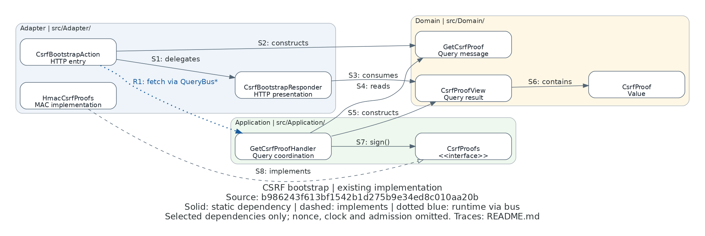

# CSRF bootstrap ownership

This is a focused view of the **existing implementation** of `GET /api/v1/auth/csrf`, documented by
[browser authentication request controls](../BROWSER_AUTH_REQUESTS.md) and the
[attribute-owned API contract](../../api/README.md). It answers: which PHP layer owns the HTTP boundary,
proof issuance coordination, signing capability and transport-free result?

**Source revision:** [`b986243f613bf1542b1d275b9e34ed8c010aa20b`](https://github.com/johnnickell/fight-agent-os/tree/b986243f613bf1542b1d275b9e34ed8c010aa20b).
This documentation-only change does not modify that PHP source. Local links below open the checkout;
use `git show b986243f613bf1542b1d275b9e34ed8c010aa20b:PATH` for the exact historical file.



[Editable Python Diagrams source](csrf-ownership.py) · [Shared standard and local setup](../DIAGRAMS.md)

Solid arrows are selected static references (consumer → referenced type); the dashed open arrow means
implements. The dotted blue R1 arrow is a **compressed runtime interaction through the configured QueryBus**,
not an Action dependency on, or direct invocation of, the handler. No return arrow or total execution ordering
is asserted by the static arrows. All boxes are real classes except the explicitly labeled `CsrfProofs` interface.

## Class/source trace

`App\` maps to `src/`. Layer groups reflect the actual files, not a proposed relocation. Subpaths below the
layer prefix identify the complete namespace; the image shortens them to class names for readability.

| Class / interface | Source below `src/` | Inspected responsibility |
|---|---|---|
| `CsrfBootstrapAction` | [Adapter/Http/Action/Api/V1/Auth/CsrfBootstrapAction.php](../../../src/Adapter/Http/Action/Api/V1/Auth/CsrfBootstrapAction.php) | `handle()` reads the nonce cookie, creates the query, fetches through injected QueryBus, validates the result type and delegates presentation |
| `CsrfBootstrapResponder` | [Adapter/Http/Responder/Api/V1/Auth/CsrfBootstrapResponder.php](../../../src/Adapter/Http/Responder/Api/V1/Auth/CsrfBootstrapResponder.php) | `respond()` consumes the result, emits no-store JSend and sets a nonce cookie only for `newNonce` |
| `HmacCsrfProofs` | [Adapter/Security/HmacCsrfProofs.php](../../../src/Adapter/Security/HmacCsrfProofs.php) | Implements `CsrfProofs`; `sign()` binds nonce, configured origin and expiry with HMAC; `verify()` is outside this issuance slice |
| `GetCsrfProofHandler` | [Application/Security/Csrf/QueryHandler/GetCsrfProofHandler.php](../../../src/Application/Security/Csrf/QueryHandler/GetCsrfProofHandler.php) | `handle()` reuses or generates a nonce, computes now + 900 seconds, signs and constructs the result |
| `CsrfProofs` | [Application/Security/Csrf/Service/CsrfProofs.php](../../../src/Application/Security/Csrf/Service/CsrfProofs.php) | Application-owned signing/verifying interface; the handler uses `sign()` here |
| `GetCsrfProof` | [Domain/Security/Csrf/Query/GetCsrfProof.php](../../../src/Domain/Security/Csrf/Query/GetCsrfProof.php) | Query carrying an optional canonical nonce; constructor validates non-null input |
| `CsrfProofView` | [Domain/Security/Csrf/Query/CsrfProofView.php](../../../src/Domain/Security/Csrf/Query/CsrfProofView.php) | Result with nonce, typed proof and new-nonce flag; this View actually lives in Domain at this revision |
| `CsrfProof` | [Domain/Security/Csrf/CsrfProof.php](../../../src/Domain/Security/Csrf/CsrfProof.php) | Validates and carries proof value/expiry |

## Arrow trace

All references in this table describe the named revision, not instrumented HTTP execution.

| Edge | Source evidence | Meaning and limit |
|---|---|---|
| S1 Action → Responder | Action constructor and final `handle()` statement | Injected Responder dependency; `respond($result)` presents the complete result |
| S2 Action → GetCsrfProof | Action `handle()`: `new GetCsrfProof($nonce)` | Constructs the Domain query, not the handler |
| S3 Responder → CsrfProofView | Responder `respond(CsrfProofView $result)` | Reads typed result fields; does not fetch business data |
| S4 Handler → GetCsrfProof | Handler `handle()`: payload `instanceof GetCsrfProof` and nonce read | Recognizes the registered query payload |
| S5 Handler → CsrfProofView | Handler `handle()`: `new CsrfProofView(...)` | Constructs the query result, including a new `CsrfProof` value |
| S6 View → CsrfProof | View constructor: `public CsrfProof $proof` | Typed contained value; no UML lifetime or cardinality claim |
| S7 Handler → CsrfProofs | Handler constructor and `$this->proofs->sign($nonce, $expiresAt)` | Static dependency is on the Application interface, not concrete HMAC |
| S8 HmacCsrfProofs → CsrfProofs | HMAC class declaration `implements CsrfProofs` | Adapter implements inward capability; [csrf.php](../../../config/application/csrf.php) binds the interface to this service |
| R1 Action ⇢ Handler (indirect) | Action `QueryBus::fetch(new GetCsrfProof(...))`; [query.php](../../../config/common/query.php) registers `GetCsrfProof::class => GetCsrfProofHandler::class`, builds the handler and configures QueryPipeline → RoutingQueryBus → ServiceAwareQueryRouter | Configured bus hop, not a direct class dependency or measured successful execution |

The source inspection also confirmed the interface binding in `config/application/csrf.php` and the injected
signing capability in `config/common/query.php`. This is why the runtime reaches an Adapter implementation
without making the handler statically depend on it.

## Scope and representation limits

- This is **not** a complete dependency graph. Omitted: nonce generator/clock interfaces and adapters, the
  handler's direct construction of `CsrfProof`, the Action's result-type check and static `HmacCsrfProofs::validNonce`
  reference, cookie/data helpers, JSend/PSR types, container internals and the rest of the request pipeline.
- HTTP routing, HTTPS/origin/Fetch/header admission, mutation-time verification, nonce rotation on login,
  authentication, permissions, refresh credentials and browser state are outside the view. In particular, proof
  issuance does not authenticate the caller. The linked runbooks retain the security and deployment contracts.
- Generic Diagrams boxes/clusters communicate these eight types and three actual layers clearly; they do not
  express UML members, visibility, multiplicity or automatic source extraction. Source evidence supplies the
  types and arrows; rendering supplies only layout. No runtime, security, acceptance or deployment proof follows.
- This depicts existing placement, **not** a certification that the whole feature conforms to the approved
  aggregate-first [architecture target](../STANDARDS.md#architecture). No proposed architecture or class moves
  are included. A future architecture change needs a separately labeled proposed view and its approved owner.
- R1 is supported by the Action and composition source; the package pipeline internals were not independently
  executed or audited for this diagram. No uncertainty is hidden by an unlabeled direct-call arrow.

## Regenerate and inspect

From the repository root, after the explicit [renderer setup](../DIAGRAMS.md#render-locally):

```sh
./bin/diagrams versions
./bin/diagrams render docs/engineering/browser-auth-requests/csrf-ownership.py
```

The Python source writes only its adjacent `csrf-ownership.png` (temporary DOT is removed by Diagrams).
Inspect that full image natively, then follow the class links and S1–S8/R1 traces at the cited revision before
claiming an update is verified. TASK-00549 records the qualified dependency versions and inspection results.
There is no additional flow image: R1 and the table explain the only cross-layer dispatch needed for this
ownership question; a full security request sequence would exceed the selected slice.
