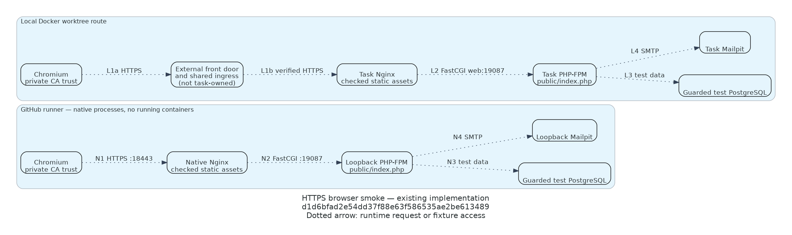

# HTTPS browser smoke runtime flow

Existing implementation at `d1d6bfad2e54dd37f88e63f586535ae2be613489`. The GitHub job uses native processes; the local worktree keeps its existing external front door and shared ingress. Both paths route PHP requests to disposable fixture FPM and serve the checked client output.

[Editable Python](runtime-flow.py) · [Browser smoke runbook](../BROWSER_SMOKE.md)

| Arrow | Source at the named revision | Meaning |
|---|---|---|
| N1 | [`scripts/browser_smoke_setup.php`](../../../scripts/browser_smoke_setup.php), native setup; [`client/scripts`](../../../client/scripts), browser journey runner | Native setup starts the loopback HTTPS gateway. Chromium uses a private trust store rather than workstation or runner-wide trust changes. |
| N2, L2 | [`scripts/browser_smoke_setup.php`](../../../scripts/browser_smoke_setup.php), `$smokeGateway`; [`scripts/browser_smoke.php`](../../../scripts/browser_smoke.php), FPM configuration; [`etc/docker/https/default.conf`](../../../etc/docker/https/default.conf), FastCGI binding | Nginx passes dynamic requests to port 19087, on loopback natively or at `web` in Docker. The front controller is `public/index.php`. |
| N3, L3 | [`scripts/browser_smoke.php`](../../../scripts/browser_smoke.php), database identity and reset checks; [Build workflow](../../../.github/workflows/build.yml), job teardown | Fixture operations and FPM use the guarded test database. The GitHub job drops only its own database and role. |
| N4, L4 | [`config/application/credential_delivery.php`](../../../config/application/credential_delivery.php), test SMTP composition; [`scripts/browser_smoke_setup.php`](../../../scripts/browser_smoke_setup.php), native Mailpit process | The test application sends to the route's disposable catcher; an initially nonempty catcher is refused rather than emptied. |
| L1a, L1b | [Local ingress runbook](../LOCAL_INGRESS.md), worktree supplier and route; [`scripts/browser_smoke_setup.sh`](../../../scripts/browser_smoke_setup.sh), task gateway setup | The existing external front door and shared ingress route the selected HTTPS origin to task Nginx. The task does not own the shared ingress or trust material. |

This is a source trace, not measured traffic. It omits the private direct Docker alternative, fixture readiness, response paths, setup and teardown ordering, and individual journeys. It does not depict production or deployment topology.

Render with `./bin/diagrams render docs/engineering/browser-smoke/runtime-flow.py`.
