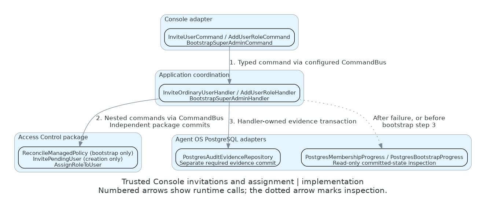

# Trusted Console command flow

[Editable diagram](command-flow.py). This implementation view describes the source in the commit that introduced this
page. The Work handoff and PR record the full implementation revision. The diagram shows runtime calls, not static
dependencies or guaranteed effects. Package and application bus filters, policy reads, event delivery, and response
formatting are omitted.

| Step | Source trace |
|---|---|
| 1. Parse and dispatch | [`InviteUserCommand`](../../../src/Adapter/Console/InviteUserCommand.php), [`AddUserRoleCommand`](../../../src/Adapter/Console/AddUserRoleCommand.php) and [`BootstrapSuperAdminCommand`](../../../src/Adapter/Console/BootstrapSuperAdminCommand.php) parse trusted local intent and dispatch their typed commands. The [invitation](../../../config/application/console_invitation.php) and [bootstrap](../../../config/application/bootstrap_super_admin.php) composition files register the handlers. |
| 2. Dispatch package work | `handle()` in [`InviteOrdinaryUserHandler`](../../../src/Application/Authorization/CommandHandler/InviteOrdinaryUserHandler.php), [`AddUserRoleHandler`](../../../src/Application/Authorization/CommandHandler/AddUserRoleHandler.php) and [`BootstrapSuperAdminHandler`](../../../src/Application/Authorization/CommandHandler/BootstrapSuperAdminHandler.php) calls the configured command bus. No outer transaction encloses the package operations. |
| 3. Record evidence | The same handlers call `commitTransactional()` around evidence `add()` through the [`PostgresAuditEvidenceRepository`](../../../src/Adapter/Persistence/Repository/PostgresAuditEvidenceRepository.php). That commit cannot roll back an earlier package commit. |
| Inspect committed state | [`PostgresMembershipProgress`](../../../src/Adapter/Persistence/Authorization/PostgresMembershipProgress.php) and [`PostgresBootstrapProgress`](../../../src/Adapter/Persistence/Bootstrap/PostgresBootstrapProgress.php) use read-only inspection separate from the writer. Bootstrap also inspects the committed invitation and assignment before writing its completion evidence. |

See [Console invitation and correction](../CONSOLE_INVITATIONS.md) and [the bootstrap runbook](../SUPER_ADMIN_BOOTSTRAP.md)
for operator-facing behavior and recovery limits. This source trace does not prove runtime behavior or acceptance.
