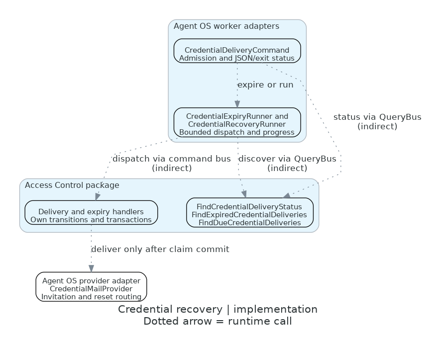

# Credential recovery worker ownership

[Editable Python source](worker-ownership.py). Implementation at
`bd4dc21dbf870fc5f1083759f31649e352cac8e8`; Access Control v0.11.0 is locked at
`6258682512e2c8d76a3fa655dd633167bd8f55b6`.

| Runtime call | Source and responsibility |
| --- | --- |
| Admit the operation and report safe results | [CredentialDeliveryCommand](../../../src/Adapter/Console/CredentialDeliveryCommand.php), `execute`: selects status, expiry, or expiry followed by recovery. |
| Discover work | [CredentialExpiryRunner](../../../src/Adapter/CredentialDelivery/CredentialExpiryRunner.php) and [CredentialRecoveryRunner](../../../src/Adapter/CredentialDelivery/CredentialRecoveryRunner.php), `run`: send bounded package queries through the configured QueryBus. |
| Offer work | [Command registrations](../../../config/common/command.php) route delivery and expiry through the configured bus. The package handlers own transactions, state changes, and audit. |
| Invoke mail | [CredentialMailProvider](../../../src/Adapter/CredentialDelivery/CredentialMailProvider.php), `deliver`: routes invitation or reset after the package claim commit. The package commits the expected outcome separately. |

This source trace omits storage internals, provider selection, immediate event dispatch, and retry details. It
does not prove a successful provider call or an acceptance verdict. See the [recovery runbook](../CREDENTIAL_RECOVERY.md)
for operational limits and recovery guarantees.
