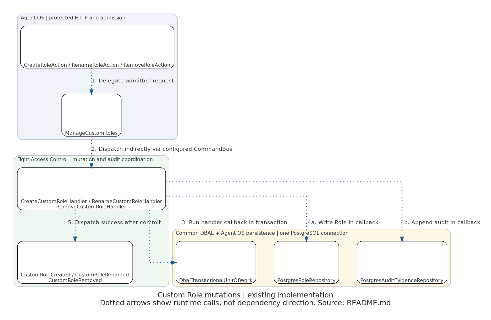

# Who owns a custom Role mutation?

Existing implementation: Agent OS entry and composition source at `feaefdd7bd2886659392670bfebfe001ae6b4d07`
(unchanged by the v0.11.0 adoption), Access Control `6258682512e2c8d76a3fa655dd633167bd8f55b6`, and Common
`c73690164a9f112dbf14d774c56a7c01519b88aa`. [Editable diagram](role-mutation.py).

| Steps | Source | What the source shows |
|---|---|---|
| 1 | [Role Actions](../../../src/Adapter/Http/Action/Api/V1/Authority/), [ManageCustomRoles](../../../src/Application/Authorization/ManageCustomRoles.php) | `CreateRoleAction`, `RenameRoleAction` and `RemoveRoleAction` delegate through the existing exact-permission path. `ManageCustomRoles` supplies the authorized actor and, for create, a generated Role ID. |
| 2 | [Role registration](../../../config/application/custom_roles.php), [shared command pipeline](../../../config/common/command.php) | `ManageCustomRoles` calls the injected `CommandBus`; the registered router selects the package handler. This is not a private call to a handler. |
| 3–4 | [Access Control Role handlers at the selected source](https://github.com/johnnickell/fight-access-control/tree/6258682512e2c8d76a3fa655dd633167bd8f55b6/src/Application/AccessControl/Role/CommandHandler), [shared persistence](../../../config/common/persistence.php) | Each handler supplies a callback to `commitTransactional` and coordinates the Role and audit writes inside it. `PostgresRoleRepository` and `PostgresAuditEvidenceRepository` use the same DBAL `Connection` as Common's `DbalTransactionalUnitOfWork`. |
| 5 | The same package handlers, after `commitTransactional` returns | The handlers publish the corresponding created, renamed or removed event only after commit. Failure to publish does not undo the commit. |

This static trace describes successful changes, not every runtime branch. A current same-name rename writes
neither state nor successful audit and emits no success event. An audit insert failure rolls the mutation back.
Removal's reference checks, authoritative reads, response mapping, and transport details are outside this view.
See the [Role runbook](../CUSTOM_ROLES.md) and [TASK-00573](../../../planning/tasks/00573-TASK.md) for behavior
and verification. The diagram is not evidence of runtime correctness or independent acceptance.
