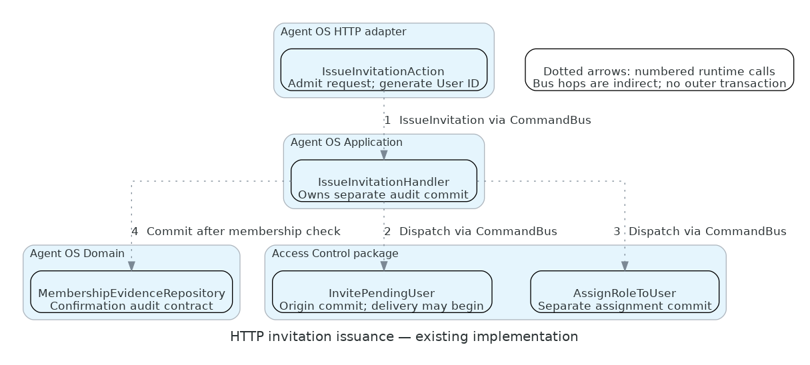

# HTTP invitation issuance flow

Existing implementation at `84cccc11496000a355421265ccbe4af61203ec80`. The view shows the ordered commitments for an admitted request, not a single transaction.

[Editable Python source](issuance-flow.py) · [Invitation API contract](../INVITATION_API.md)

| Step | Source | What happens |
|---|---|---|
| 1 | [`IssueInvitationAction::handle`](../../../src/Adapter/Http/Action/Api/V1/Invitations/IssueInvitationAction.php), [registration](../../../config/application/invitation_api.php) | The action admits the exact operation, supplies a new ID and dispatches the owned intent. The bus resolves its registered handler. |
| 2 | [`IssueInvitationHandler::handle`](../../../src/Application/Invitation/CommandHandler/IssueInvitationHandler.php) | The handler dispatches `InvitePendingUser`; Access Control owns the origin commit and can start delivery afterward. |
| 3 | [`IssueInvitationHandler::handle`](../../../src/Application/Invitation/CommandHandler/IssueInvitationHandler.php) | The handler dispatches `AssignRoleToUser`; Access Control owns the assignment commit. |
| 4 | [`MembershipEvidenceRepository::add`](../../../src/Domain/Authorization/MembershipEvidenceRepository.php), [`IssueInvitationHandler::handle`](../../../src/Application/Invitation/CommandHandler/IssueInvitationHandler.php) | After a safe membership read, the handler commits its own confirmation evidence. The repository interface is in Domain; it does not commit. |

The view omits rate budgets, safe delivery reads, failures, status and recovery endpoints. The source trace does not establish runtime acceptance or recipient receipt.
