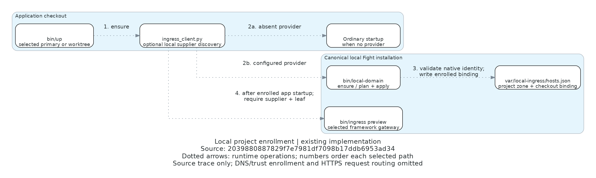

# Local registration flow

[Editable Python](registration-flow.py) · [Owning feature](../LOCAL_DOMAINS.md)

Existing implementation source: `2039880887829f7e7981df7098b17ddb6953ad34`.
The later documentation commit changes no represented implementation. Dotted directed edges are
runtime operations, not static dependencies or verified deployment. Step 4 describes framework
consumers; Fight's own runtime selects its enrolled origin through its native shared HTTPS path.

| Arrow | Source at the named revision | Inspected meaning |
| --- | --- | --- |
| 1, 2a, 2b | [ingress_client.py](../../../scripts/ingress_client.py), `supplier` / `ensure` | Optional user-local pointer or explicit environment override; configured unavailable supplier fails |
| 3 | [local_domain.py](../../../scripts/local_domain.py), `ensure`, `persist`, `apply` | Unenrolled project returns no binding; enrolled checkout validates native identity and TASK before atomic registry update |
| 4 | [ingress_client.py](../../../scripts/ingress_client.py), `preview`; [ingress_preview.py](../../../scripts/ingress_preview.py), `up` | Consumer starts its own app first; preview requires actual service, supplier and certificate readiness |

The framework copies of `ingress_client.py` use the same interface. Their runtime wrappers call
`ensure` before preparation and `preview` after normal startup; build-only setup does not start a gateway.
No-provider and unenrolled ordinary startup remain available. Registration is distinct from DNS,
certificate issuance/trust, gateway startup, and ordinary browser readiness. Those paths, HTTP request
routing, failure branches within atomic persistence, and future browser Project creation are omitted.
No hosted service writes a workstation registry. This source trace proves no acceptance or deployment.
