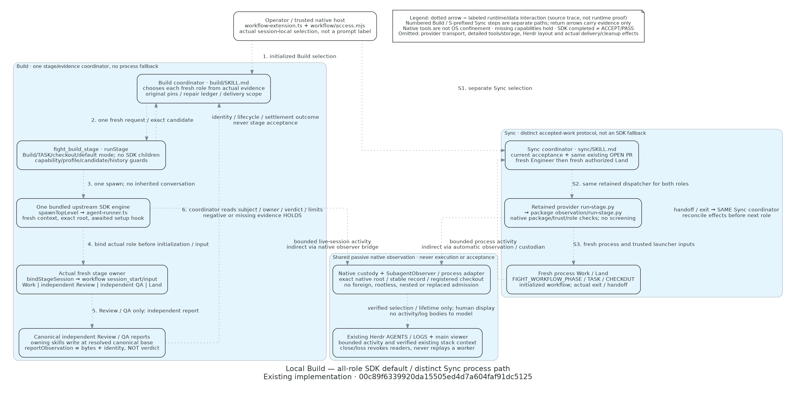

# Local Build SDK and retained Sync flow

**Existing implementation source: `00c89f6339920da15505ed4d7a604faf91dc5125` (TASK-00561 stage 3).**
[Editable Python](workflow-flow.py). The artifact commit may follow that implementation revision. This replaces,
not relabels, the historical Engineer-only image at `e4959587b6721c174ca78b11a72e58492b8243c2`; retrieve that older
Python/PNG/caption through Git when inspecting its original evidence.

This bounded runtime/data-flow view answers: who initializes and executes all four Build roles, who judges their
evidence, and why Sync's process launcher survives? Build is the sole stage/evidence coordinator; one bundled
upstream engine executes SDK workers. Explicit Sync is a distinct accepted-work caller of the retained process
launcher, not a permanent Build fallback. Neither profile names, tool visibility nor pane state grant authority.

**Legend:** dotted directed arrows are the labeled runtime/data interactions traced below, including compressed
indirect observation hops; they are not static dependencies or proof that a runtime path succeeded. Build steps
1–6 and Sync steps S1–S3 are separate paths. Return arrows carry handoff/evidence, not an automatic verdict or a
worker's authority to launch its successor. Only the actual coordinator chooses each next fresh owner.

## Source and arrow trace

All rows name source at the full implementation revision above. Retrieve with `git show REVISION:PATH`; current
relative links provide navigation, not immutable source identity.

| Arrow / boundary | Source at that revision | Meaning and evidence limit |
|---|---|---|
| 1 / S1. Operator → coordinator | [`WorkflowAccess.input/restore`](../../../harness/pi/src/workflow/access.mjs), [`installWorkflow`](../../../harness/pi/src/workflow-extension.ts) | Native interactive selection or trusted host binding initializes the actual session's responsibilities. RPC/extension/model input cannot select authority. Build and Sync are coordination/QA phase, not QA workers. |
| 2. Build → stage tool | [Build owning skill](../../../.pi/skills/build/SKILL.md#pin-models-then-launch-fresh-roles), [`installBuildStages`](../../../harness/pi/src/build-stages-extension.ts), [`prepareStage`](../../../harness/pi/src/build/stages.mjs), [`stageHistory`](../../../harness/pi/src/build/history.mjs) | Sole fresh default, without selector flag. Actual Build/TASK/checkout/default mode, explicit non-SDK parent, exact registered candidate/context, capabilities/profile, original pins/repairs and settled prior attempt are required. Missing support holds; no process fallback. Sequential execution and reload checkpoints do not schedule the next stage. |
| 3. Tool → one SDK engine | [`runStage`](../../../harness/pi/src/build/stages.mjs), [`spawnTopLevel/registryEntry`](../../../harness/pi/vendor/pi-subagents/src/index.ts), [`agent-runner` setup](../../../harness/pi/vendor/pi-subagents/src/agent-runner.ts) | One spawn with exact model/thinking/checkout, `inheritContext: false` and the actual bound root. The awaited setup hook runs after factories but before extension binding, session_start and prompting. No alternate session engine, nesting or automatic worktree management. |
| 4. Engine → initialized owner | [`bindStageSession/stageIdentity`](../../../harness/pi/src/build/authority.mjs), [workflow session_start/input](../../../harness/pi/src/workflow-extension.ts), [stage profiles](../../../harness/pi/agents/) | Fresh actual SessionManager, native context, storage, extensions, exact role/skill/effects and model are checked before execution. Input verifies initialized identity. Concurrent contexts cannot borrow a launcher via process-global mutation. Unbound SDK siblings stay Reviewer; even a Build-shaped SDK workflow cannot dispatch nested Build. |
| 5. Owner → canonical reports | [Review](../../../.pi/skills/review/SKILL.md), [QA](../../../.pi/skills/qa/SKILL.md), [`reportSnapshot/runStage`](../../../harness/pi/src/build/stages.mjs) | Only independent Review/QA owners write canonical reports under their role responsibilities. Runtime derives the path from the canonical base and observes refreshed bytes/session/candidate metadata. This is neither a parsed verdict nor hostile-local-code writer attestation. Work/Land use their own handoffs, omitted here. |
| 6. Reports → SAME Build coordinator | [Build advancement](../../../.pi/skills/build/SKILL.md#advance-by-evidence), [execution/handoff standards](../EXECUTION.md) | Instruction-owned inspection checks actual subject, independence, Spec/Standards/scenarios, verdict, newer findings and limits. Negative/missing/wrong-candidate evidence cannot advance. SDK completed/steered/exit zero and `reportObservation` cannot substitute for ACCEPT/PASS. This arrow is a coordinator obligation, not a new report parser or scheduler. |
| Outcome → SAME Build | [`runStage`](../../../harness/pi/src/build/stages.mjs), [attempt checkpoints](../../../harness/pi/src/build-stages-extension.ts) | Identity/lifecycle/outcome only; acceptance always false. Finite timeout/cancel/reload grace requires original run promise/controller/start identity plus non-streaming session settlement. Unknown/replaced execution holds replacement and requires external-effect reconciliation; no old assessor reuse or blind publication replay. |
| S2 / S3. Sync → process owner | [Sync owning process protocol](../../../.pi/skills/sync/SKILL.md#process-stage-protocol), [unchanged provider launcher](../../../.pi/skills/build/scripts/run-stage.py), [package monitor](../../../harness/pi/src/observation/run-stage.py), [workflow extension](../../../harness/pi/src/workflow-extension.ts) | Same demonstrated process path for fresh accepted-work Engineer then fresh Land. Native inventory/trust/package injection and launcher role/TASK/checkout remain. No evaluator preflight. Exact live PR, original acceptance and intent-preserving integration are owning Sync obligations; it cannot use the Build-only SDK tool. |
| Process handoff → SAME Sync | [Sync progression/reconciliation](../../../.pi/skills/sync/SKILL.md), [Work integration assignment](../../../.pi/skills/sync/references/integration.md) | Observe actual exit, committed handoff and required checks before next owner. Engineer never dispatches Land. Unknown liveness/effects holds retry. Existing [Sync diagram](../sync/README.md) remains explicitly revision-pinned historical source evidence; this update does not relabel it. |
| SDK/process → shared observation | [`SubagentObserver`](../../../harness/pi/src/observation/subagents.mjs), [native bridge](../../../harness/pi/src/native-observation-extension.ts), [`AutomaticObservation`](../../../harness/pi/src/observation/automatic_observation.py), [custodian](../../../harness/pi/src/observation/custodian.mjs) | Compressed indirect hops emit bounded activity to existing passive custody. Stable native root/record/session and ancestry are required. No transcript-file ingestion, reasoning, tool arguments/results or execution substitution. Shared `session-file-birth.py` also serves native parent custody, not only the process path. |
| Observation → companions/viewer | [`RegisteredChildren`](../../../harness/pi/src/workspace/registered-children.mjs), [Herdr activity](../../../harness/pi/src/herdr/activity.mjs), [workspace contract](../../../harness/pi/WORKSPACE.md) | Existing parent/panes follow verified siblings and exact registered worktree/log context. Explicit history/pins remain passive; close or lost custody withdraws source authority. Logs use separately verified existing stack identities. No body/log output enters model context and display failure cannot replay a worker. |

## Scope, history and remaining evidence

The view represents source and executable instructions, not a claim of independent acceptance, live default-host
adoption, successful all-role delivery, process isolation or OS-enforced permissions. Native file/shell tools
remain Pi's; the separately selected deterministic shell policy qualifies only its own routes. The diagram omits
provider transport, detailed native tools, accounting/storage internals, Herdr layout, application services and
actual publication/cleanup effects. No unverified future managed Runner or server grant is drawn.

[TASK-00561's approved staged contract](../../../planning/tasks/00561-TASK.md#approved-staged-qualification--2026-11-07)
retains bounded bootstrap Review/native QA as evidence of their original candidate/install. Stage-3 source cutover
requires fresh complete-implementation independent Review/applicable final QA. Actual authorized Land of this
same accepted TASK then supplies delivery evidence, not a circular prerequisite for its own authorization.
Source changes never migrate the active copied parent/shared installations. See [default/adoption guidance](../../../harness/pi/SUBAGENTS.md#all-role-build-default).

Render with `./bin/diagrams render docs/engineering/native-workflow/workflow-flow.py`, record actual versions and
inspect the entire PNG under the [diagram contract](../DIAGRAMS.md). Successful rendering alone proves neither
behavior nor acceptance. Publication and everyday installation remain separately authorized effects.
