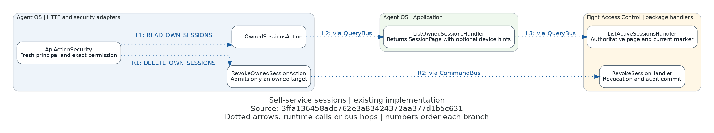

# Self-service session request flow

Existing implementation at `3ffa136458adc762e3a83424372aa377d1b5c631`. This view follows the two
`/api/v1/me/sessions` operations from HTTP admission to their package handlers. Dotted arrows show runtime
calls, not static dependencies. The `L` and `R` labels order the list and revoke paths independently.

| Edge | Source trace and meaning |
|---|---|
| L1, R1 | [`ApiActionSecurity::process()`](../../../src/Adapter/Http/Middleware/Api/Auth/ApiActionSecurity.php) extracts the bearer credential, verifies current user and session state through the [security adapter](../../../src/Adapter/Security/AccessToken/AuthenticateAccessToken.php), constructs a request-local principal provider and checks the action's own permission. |
| L2 | [`ListOwnedSessionsAction::handle()`](../../../src/Adapter/Http/Action/Api/V1/Sessions/ListOwnedSessionsAction.php) sends the admitted user's ID, current session ID and bounded pagination on the configured query bus. |
| L3 | [`ListOwnedSessionsHandler::handle()`](../../../src/Application/Security/Session/QueryHandler/ListOwnedSessionsHandler.php) dispatches package `ListActiveSessions` through the same bus. The package validates scope and page, including the current-session marker. The owned handler adds optional coarse hints only for returned session IDs and sends a typed result back to HTTP. |
| R2 | [`RevokeOwnedSessionAction::handle()`](../../../src/Adapter/Http/Action/Api/V1/Sessions/RevokeOwnedSessionAction.php) checks the target's ownership before sending `RevokeSession` directly through the command bus. The package handler owns lifecycle checks, the revocation and audit transaction, and post-commit notification. |

[`config/application/sessions.php`](../../../config/application/sessions.php) registers the package and owned
handlers. Access Control v0.11.0 (`6258682512e2c8d76a3fa655dd633167bd8f55b6`) supplies both package handlers.

The diagram omits return arrows, response formatting, device persistence and cleanup, business locks, the
separate installation administration routes, and the browser login/refresh/logout and CSRF pipelines. It is a
source trace, not proof of runtime security or independent acceptance. See [owned sessions](../OWNED_SESSIONS.md)
for behavior and wire contracts, and [editable Python](session-requests.py) for the image source.
