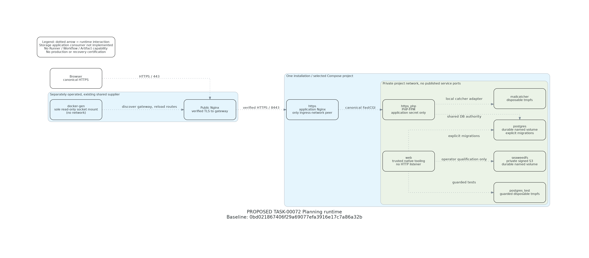

# Proposed Planning runtime boundary

Editable [Python source](topology.py). This is the proposed TASK-00072 transition from baseline
`0bd021867406f29a69077efa3916e17c7a86a32b`, not a claim of independent acceptance or a baseline storage service.
The final candidate's TASK/handoff supplies its exact committed source and fresh qualification limits.

| Trace | Source | Meaning |
|---|---|---|
| Shared supplier | [local ingress](../LOCAL_INGRESS.md), `scripts/local_ingress.py` | Existing separate Nginx/docker-gen; only discovery mounts a socket |
| Application peers, secrets, volumes | [compose.yaml](../../../compose.yaml) | Only gateway receives external ingress membership through the generated override; private services publish no ports |
| Gateway → FPM | [gateway configuration](../../../etc/docker/https/default.conf), `scripts/resource_lifecycle/preparation.py:ingress` | Exact canonical authority, TLS, closed forwarding metadata and FastCGI |
| FPM/tooling → PostgreSQL | Compose service secrets and `etc/docker/php/runtime-secrets.php` | One application database URL; tooling additionally receives a separate guarded test URL |
| FPM → Mailpit | Existing local catcher adapter, `config/application/credential_delivery.php` | Local test delivery only; not a real email provider |
| Tooling → storage | [operator guide](../PLANNING_RUNTIME.md) | Direct native signed S3 qualification, not an application Artifact adapter |

Dotted arrows are runtime interactions, not PHP static dependencies. Infrastructure/service ownership is shown;
class ownership, domain transactions, TLS enrollment, host DNS and future storage consumers are omitted. Source
configuration is not runtime proof. The TASK records fresh direct probes and any blocked canonical ingress or
recovery evidence. Rendering this picture neither starts services nor qualifies security.
