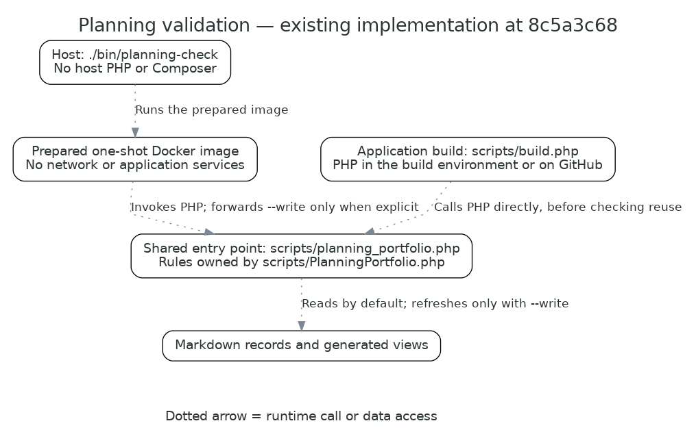

# Planning validation entry points

The [Planning guide](../../../planning/README.md) explains when to validate or refresh. This view shows how the host command and the build reach the same PHP validator without asking the build to run Docker for Planning.

**Existing implementation:** `8c5a3c68ac730e15aa8d60e664c771c6b6925f90`. [Editable Python source](entry-points.py).

| Runtime step | Source at the implementation revision | What the source shows |
|---|---|---|
| Host command → one-shot container | [`bin/planning-check`](../../../bin/planning-check) | Checks for a prepared image and runs with `--pull=never --network=none`; mounts the checkout read-only unless `--write` is explicit. It does not start application services. |
| Container → PHP entry point | [`bin/planning-check`](../../../bin/planning-check) | Uses the image's PHP as the entry point for `php -n scripts/planning_portfolio.php`, with `--write` only for refresh. |
| Build → PHP entry point | [`scripts/build.php`](../../../scripts/build.php), Planning validation; [GitHub workflow](../../../.github/workflows/build.yml), canonical gate step | The build calls the same script with `PHP_BINARY` and `-n`. A Planning failure exits before application phases or reuse checks. The workflow invokes the build with runner PHP. |
| PHP entry point → Markdown | [`scripts/planning_portfolio.php`](../../../scripts/planning_portfolio.php), [`scripts/PlanningPortfolio.php`](../../../scripts/PlanningPortfolio.php) | The entry point passes the selected mode to the validator and refresh owner. Default validation does not write; explicit refresh updates generated views and eligible parent status. |

The dotted arrows show calls or data access, not deployment or test results. Image setup, archive preflight, and other build phases are out of scope. This source trace is not evidence that the hosted Planning step has run.
