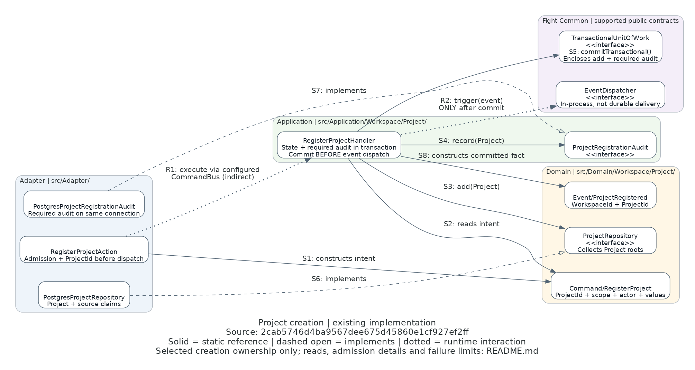

# Project creation ownership

**Existing implementation source:** `2cab5746d4ba9567dee675d45860e1cf927ef2ff` (TASK-00575).
The diagram/documentation commit may follow this source revision. Relevant PHP/configuration/test source must
remain unchanged for this picture to apply. Retrieve the cited source with `git show FULL_SHA:PATH`.

[Editable Python](project-ownership.py) · [operational runbook](../REPOSITORY_REGISTRATION.md)

This is a retained historical ownership view. TASK-00572 subsequently replaces only S5's concrete transaction
composition with Common v1.5.0 `DbalTransactionalUnitOfWork` on the same shared Connection, removing the unused
EntityManager. The depicted generic ports, handler coordination and event ordering remain unchanged;
[the current transaction runbook](../TRANSACTIONS.md) owns that implementation/failure contract. The image does
not claim to depict current concrete transaction internals.

## Question and scope

Who owns Project creation, state/source claims, required audit and publication after replacing the registration
Store? This is a selected **class/layer ownership view**, not the whole class graph or a measured sequence.
Solid directed edges are static references; dashed open arrows implement a port; dotted arrows describe runtime
interactions. R1 deliberately compresses the configured bus pipeline/router, not a direct Action-to-handler call.
S3/S4 labels name calls visible in the handler; S5 encloses both before R2. Static arrows alone establish no order.

## Source and arrow traces

The full implementation revision above is the source authority for every row. Links locate files in this checkout;
they do not imply that every later revision has already been inspected.

| Trace | Source and method | Meaning |
|---|---|---|
| S1 | [RegisterProjectAction](../../../src/Adapter/Http/Action/Api/V1/Projects/RegisterProjectAction.php), `handle()`; [RegisterProject](../../../src/Domain/Workspace/Project/Command/RegisterProject.php) | Validates/maps transport, derives trusted actor/Workspace scope and generates typed ProjectId before void dispatch; no mutable command result |
| S2 | [RegisterProjectHandler](../../../src/Application/Workspace/Project/CommandHandler/RegisterProjectHandler.php), `handle()` | Checks message type and coordinates the supplied intent, without a second transport permission gate |
| S3 | Same handler; [Project](../../../src/Domain/Workspace/Project/Project.php), `register()`; [ProjectRepository](../../../src/Domain/Workspace/Project/ProjectRepository.php), `add()` | Builds the root using the supplied ID/values and adds state/source claims, not an HTTP result |
| S4 | Same handler; [ProjectRegistrationAudit](../../../src/Application/Workspace/Project/ProjectRegistrationAudit.php), `record()` | Explicit required audit collaborator; no inference from callback return, repository interception or success subscriber |
| S5 | Same handler, `commitTransactional()`; [shared persistence composition](../../../config/common/persistence.php) | Common Doctrine UoW and EntityManager use the exact Connection also injected into Project persistence and required audit |
| S6 | [PostgresProjectRepository](../../../src/Adapter/Persistence/Workspace/Project/PostgresProjectRepository.php) | Implements aggregate collection persistence, bounded reads and canonical claim membership; recognized named constraints arbitrate creation; no independent commit/flush |
| S7 | [PostgresProjectRegistrationAudit](../../../src/Adapter/Persistence/Workspace/Project/PostgresProjectRegistrationAudit.php) | Appends safe audit to the same active transaction/connection; required failure rolls creation back |
| S8 | Handler; [ProjectRegistered](../../../src/Domain/Workspace/Project/Event/ProjectRegistered.php) | Constructs only identity/scope facts after successful transaction completion |
| R1 | Action → configured CommandBus → handler; [Project composition](../../../config/application/project.php), [command composition](../../../config/common/command.php) | Registered indirect pipeline/router dispatch, not a private handler call or separate service graph |
| R2 | Handler → injected Common EventDispatcher, `trigger()` | Post-commit in-process publication; failure may follow committed success and proves neither rollback nor durable delivery |

## Current reads and HTTP boundary outside the picture

[GetProjectAction](../../../src/Adapter/Http/Action/Api/V1/Projects/GetProjectAction.php),
[ListProjectsAction](../../../src/Adapter/Http/Action/Api/V1/Projects/ListProjectsAction.php) and
[PreviewProjectConflictsAction](../../../src/Adapter/Http/Action/Api/V1/Projects/PreviewProjectConflictsAction.php)
receive fresh central READ_PROJECTS admission. [ProjectWorkspaceAdmission](../../../src/Adapter/Http/Api/V1/Projects/ProjectWorkspaceAdmission.php)
then checks initial Workspace and current managed administrator membership. Creation uses independent REGISTER_PROJECTS.
There is no permission-revocation/commit serialization; an admitted request may finish after revocation.

All three queries traverse the configured QueryBus into registered
[query handlers](../../../src/Application/Workspace/Project/QueryHandler/). Repository lookups return aggregates
or null; handlers project [ProjectView, ProjectPage and ProjectConflicts](../../../src/Application/Workspace/Project/View/).
Required absence uses qualified Common ResourceNotFound; infrastructure failure is not absence. Reads do not
bootstrap, mutate state, audit success or publish events. Safe immutable Git-source values are evidence, not
checkout availability. [HTTP Data/Responders](../../../src/Adapter/Http/Responder/Api/V1/Projects/) own serialization,
status and headers, including the creation-only response containing the entry-known project_id.

## Omissions and limits

- The picture omits admission middleware/helper, root/value/ID nodes, read handlers/Views, Responders, clocks,
  concrete bus/Doctrine internals, database tables/locks, schema migration and error boundary. Source traces name
  the relevant omitted owners without claiming full graph completeness or runtime observation.
- State, source claims and required audit share a transaction. Canonical source/slug uniqueness remains database
  authority; advisory reads reserve nothing. Unknown infrastructure/commit failure is not a safe business conflict.
- Lost response or post-commit dispatch failure reconciles through fresh independently authorized list/detail reads.
  A new create may conflict. There is no original-response replay, automatic physical effect or exactly-once event.
- Historical identities, source facts, grants, audit attribution/correlation and distinct initial facts are retained
  through the generated migration. The runbook owns the deliberate breaking HTTP/permission/schema contract.
- This picture and static source traces establish selected ownership/references only, not correctness, security,
  behavioral acceptance, independent Review/QA, publication or deployment. The owning TASK and canonical Work
  handoff identify actual commands, source subjects, migration evidence, gate results, warnings and browser holds.
