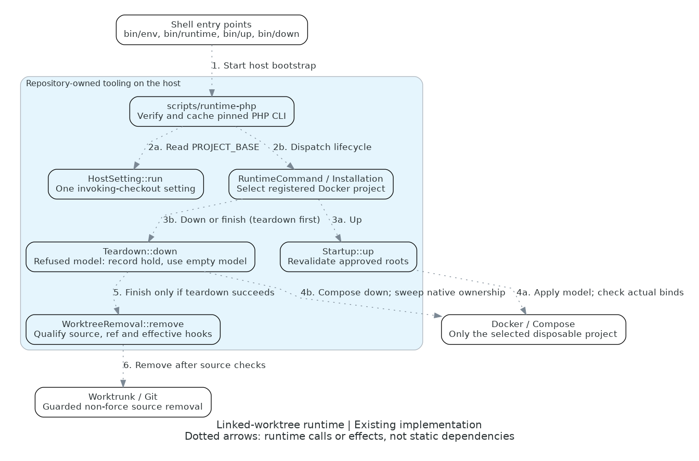

# Linked-worktree host runtime

**Existing implementation at `d8da0f8b269c22a69305e753420de2a1ec401bdb`.**
[Editable Python](host-runtime.py) · [Resource procedure](../RESOURCE_LIFECYCLE.md).

| Step | Source trace at that revision |
|---|---|
| 1 | [`bin/env`](../../../bin/env) and [`bin/runtime`](../../../bin/runtime) invoke [`scripts/runtime-php`](../../../scripts/runtime-php); [`bin/up`](../../../bin/up) and [`bin/down`](../../../bin/down) go through `bin/runtime`. The bootstrap selects the host CLI by platform and verifies the archive SHA-256 before installing it in the Git common directory cache. |
| 2a | [`scripts/host-setting.php`](../../../scripts/host-setting.php) calls [`HostSetting::run`](../../../scripts/Runtime/HostSetting.php). This branch strips ambient Git routing when resolving the invoking checkout, reads only the permitted setting, and does not call Docker. |
| 2b | [`scripts/runtime.php`](../../../scripts/runtime.php) calls [`RuntimeCommand::run`](../../../scripts/Runtime/RuntimeCommand.php). [`Installation::resolve`](../../../scripts/Runtime/Installation.php) uses native Git registration or, for teardown, a qualified exact locator/path. |
| 3a–4a | [`Startup::up`](../../../scripts/Runtime/Startup.php) calls [`ApprovedRoots::reconfigure`](../../../scripts/Runtime/ApprovedRoots.php), applies the admitted Compose model and checks reported file binds before publishing the runtime snapshot. |
| 3b–4b | `RuntimeCommand` dispatches ordinary down to [`Teardown::down`](../../../scripts/Runtime/Teardown.php); finish reaches it through [`WorktreeRemoval::finish/remove`](../../../scripts/Runtime/WorktreeRemoval.php). A refused saved teardown model yields a hold, never Compose input; the empty fallback model and native project-label sweep still permit separately qualified Docker cleanup. |
| 5–6 | After complete Docker teardown, the finish orchestrator resumes source qualification and invokes native Worktrunk non-force removal only after its guards pass. Ordinary down does not select this branch. An incomplete teardown retains source. |

The arrows show ordered effects and continuations, not necessarily direct calls. This view was traced against
host tooling source; it is not a runtime observation. It omits the application request path, shared ingress
supply, main runtime, runtime-free fixtures, and detailed filesystem, publication and consumer guards.
