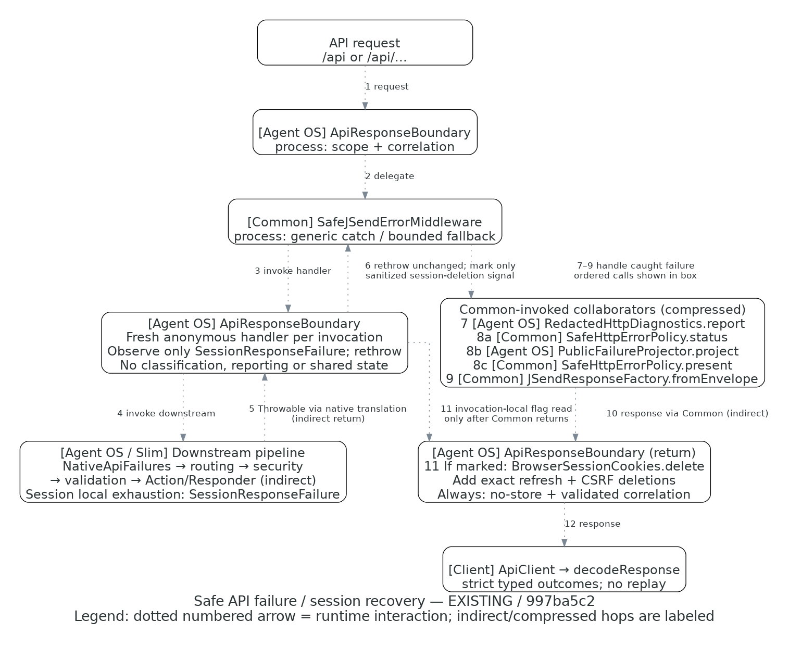

# API failure and session recovery flow

**Existing implementation**, source commit **`997ba5c20e9faebb18c2f6be839d2dd2f09edfd1`** (image label
`997ba5c2`). [Editable Python source](api-failure-flow.py); [owning contract](../SAFE_HTTP_ERRORS.md).

Legend: dotted directed edges are numbered runtime interactions, not static dependency arrows or transaction
boundaries. Indirect hops are explicitly compressed. No color conveys authority or acceptance.

## Source and arrow traces

All Agent OS paths below refer to the full source commit above; `git show SOURCE_SHA:path` retrieves them.
Common paths refer to the locked v1.4.1 source `a482c220d312d2ef7762c3f0d85d9fb76a7021fa`.

| Steps / endpoints | Source / inspected meaning |
|---|---|
| 1–2 request → scope → Common | [`ApiResponseBoundary::process`](../../../src/Adapter/Http/Middleware/Api/ApiResponseBoundary.php) selects exact API scope, validates/generates correlation and calls the injected Common middleware |
| 3–6 invocation guard / downstream / translated throw | [`ApiResponseBoundary::process`](../../../src/Adapter/Http/Middleware/Api/ApiResponseBoundary.php) constructs a fresh anonymous handler around the real downstream handler. [`config/middleware.php`](../../../config/middleware.php), [`NativeApiFailures::process`](../../../src/Adapter/Http/Middleware/Api/NativeApiFailures.php) and [`API routes`](../../../config/routes/01-api-v1.php) retain Slim LIFO routing/security/validation/Actions inside Common. The guard marks only [`SessionResponseFailure`](../../../src/Adapter/Http/Api/V1/Auth/SessionResponseFailure.php), rethrowing unchanged; other failures pass through. [`SessionLifecycleResponder::unavailable`](../../../src/Adapter/Http/Responder/Api/V1/Auth/SessionLifecycleResponder.php) throws this fixed, cause-free signal only after bounded local response/deletion rendering fails |
| 7 Common → diagnostics | Common `src/Adapter/Middleware/Psr15/SafeJSendErrorMiddleware.php::process` offers the caught failure once. [`RedactedHttpDiagnostics::report`](../../../src/Adapter/Http/Api/Failure/RedactedHttpDiagnostics.php) filters expected refusals and redacts before any logger formatter |
| 8 Common → policy/projector | Common `src/Adapter/Http/Error/SafeHttpErrorPolicy.php::{status,present,fallback}` owns generic categories/fallback. [`PublicFailureProjector::project`](../../../src/Adapter/Http/Api/Failure/PublicFailureProjector.php) supplies independently authored public fields, intent and protocol metadata |
| 9–10 Common → factory → adapter return | Common `src/Adapter/Http/Psr17/JSendResponseFactory.php::fromEnvelope`; the same fixed supplier fallback remains bounded and nonrecursive, without a new retry |
| 11 invocation flag → adapter return | After Common successfully returns, `ApiResponseBoundary::process` reads that invocation's flag and adds both [`BrowserSessionCookies::delete`](../../../src/Adapter/Http/Api/V1/Auth/BrowserSessionCookies.php) identities if marked. It always adds no-store/correlation. The flag/handler is local, not retained in the shared boundary; a returned response or exception cannot contaminate the next request |
| 12 response → client | [`ApiClient`](../../../client/src/api/ApiClient.ts) and [`decodeResponse`](../../../client/src/api/decodeResponse.ts) enforce the exact current envelope/status/data contract, retaining only declared typed data and no automatic mutation retry |

Composition is shared through [`http_failures.php`](../../../config/application/http_failures.php). The local
relative links navigate current source; the source commit above pins this diagram's actual inspected snapshot.
Behavioral evidence is in the TASK/Work handoff, not inferred from these arrows.

## Scope and omissions

This picture shows the **thrown** API failure path and the narrow exhausted-session-rendering branch, not the
complete class graph, HTTP deployment, bus internals, Doctrine transaction, success path or independent acceptance.
Ordinary direct refresh/logout responses still use the same sink/Common policy and `SessionResponder::clear`;
they do not become invented Throwables. Only exhausted local rendering carries its required deletion obligation
through the invocation guard and Common's outer recovery. Reporter failure can shorten available rendering
attempts; no response is guaranteed even when a hypothetical later factory call might succeed. A final sanitized
escape has no private previous cause. Direct safe validation/CSRF responses, detailed local attempts, ordinary
conflict/admission no-clear and terminal/logout success are omitted. Role/session-revocation package failures
retain explicit native translations. Startup/non-API/broken-factory escapes gain no valid response guarantee.

The source establishes calls/ownership and Slim registration order. Functional/integration checks separately
exercise covered behavior; the diagram does not prove security, exactly-once delivery, rollback, browser trust
or production readiness. Canonical local :443/browser qualification is currently held on privileged Herd
configuration test/reload; supplier-only verified TLS probes are not browser acceptance.
