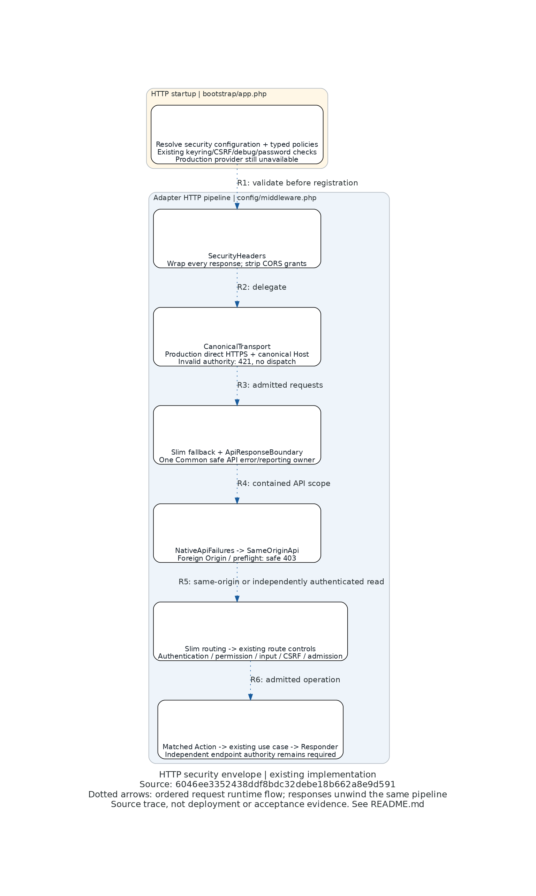

# HTTP security envelope flow

Existing implementation, source revision **6046ee3352438ddf8bdc32debe18b662a8e9d591**.
[Editable Python](http-flow.py). [Policy and operating limits](../SECURITY_ENVELOPE.md).

Legend: dotted directed arrows show ordered request runtime flow, not static class dependencies.
Responses unwind the pipeline; the outer header policy therefore wraps errors as well as successful responses.
The picture is a bounded source trace, not runtime/deployment/acceptance evidence.

| Arrow | Source at the revision above | Inspected meaning |
|---|---|---|
| R1 | [`bootstrap/app.php`](../../../bootstrap/app.php), security resolution before route/middleware registration; [`security_envelope.php`](../../../config/application/security_envelope.php) shared factories | Resolve typed configuration/policies before serving; existing production provider refusal remains |
| R2 | [`config/middleware.php`](../../../config/middleware.php), Slim last-in-first-out registration; [`SecurityHeaders::process`](../../../src/Adapter/Http/Middleware/SecurityHeaders.php) | Headers wrap transport and downstream responses; no Access-Control grant escapes |
| R3 | [`CanonicalTransport::process`](../../../src/Adapter/Http/Middleware/CanonicalTransport.php) | Production-like direct canonical HTTPS/Host only; invalid authority returns 421 without Action dispatch |
| R4 | [`ApiResponseBoundary::process`](../../../src/Adapter/Http/Middleware/Api/ApiResponseBoundary.php), middleware registration above | Existing sole Common safe API boundary wraps native translation/origin denial; non-API fallback stays independent |
| R5 | [`SameOriginApi::process`](../../../src/Adapter/Http/Middleware/Api/SameOriginApi.php) | Deny foreign/null/malformed Origin and preflight negotiation before routing; absence does not grant endpoint authority |
| R6 | [`routes/01-api-v1.php`](../../../config/routes/01-api-v1.php) and [`02-web.php`](../../../config/routes/02-web.php) | API route group retains current authentication, permission, input and journey-specific controls before actual Action dispatch; browser shell has independent client presentation |

Retrieve any source with `git show 6046ee3352438ddf8bdc32debe18b662a8e9d591:path`.
The diagram compresses Common/Slim internals and route-specific middleware; it does not claim every Action
uses the same guards or a bus (sensitive synchronous package operations retain their contract). Static dependency
direction, TLS gateways, provider delivery and transactions are deliberately not represented. Production boot
success is unavailable without the separately qualified real provider. Local main retains its HTTP development
root; production transport rejection is not a claim that local HTTP redirects. Normal canonical browser ingress
is held on the current host even though diagnostic supplier-port HTTPS works. Source-arrow inspection is not
proof of those operational effects.
