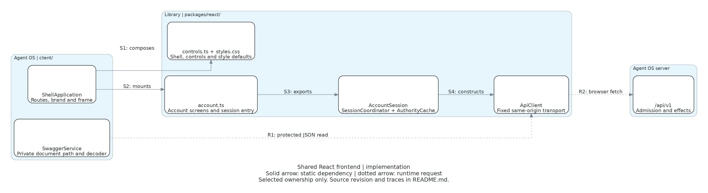

# Who owns the browser account journeys?

Work candidate for [TASK-00596](../../../planning/tasks/00596-TASK.md), implementation source `f87ed9391a1f3db78348b7101fda086c221207b9`, based on
`dbe74e35efde21cc3b305d582d8e7b216e628826`. The adjacent revision identifies the sources represented by the image.

[Editable diagram](ownership.py). The view traces the implementation sources below. It does not represent
all account transitions, server-side admission, API compatibility results, or independent acceptance.

| Edge | Source and meaning |
|---|---|
| S1 | [`ShellApplication`](../../../client/src/ShellApplication.tsx) uses public controls and supplies its brand; [`main`](../../../client/src/main.tsx) imports the compiled stylesheet. |
| S2 | [`ApplicationJourney`](../../../client/src/routes/ApplicationJourney.tsx) selects account screens and retains host routing. [`useApplicationSession`](../../../client/src/features/auth/useApplicationSession.ts) joins the account session to the host's intent and Swagger adapters. |
| S3 | [`account.ts`](../../../packages/react/src/account.ts) exports the account screens and lifecycle entry used by the host. |
| S4 | [`AccountSession`](../../../packages/react/src/features/auth/AccountSession.ts) builds the single credential store, principal cache, coordinator, and same-origin transport graph. |
| R1 | [`SwaggerService`](../../../client/src/features/swagger/SwaggerService.ts) owns the private document path and decoder. It uses the same session transport as the rest of the host, not a second credential store. |
| R2 | [`ApiClient`](../../../packages/react/src/api/ApiClient.ts) dispatches the qualified same-origin request. The server remains authoritative. |

The npm package does not import the host. Swagger, Dashboard, and the route manifest are not packed. The
[package guide](../../../packages/react/README.md) describes consumer composition and the supported theme overrides.
