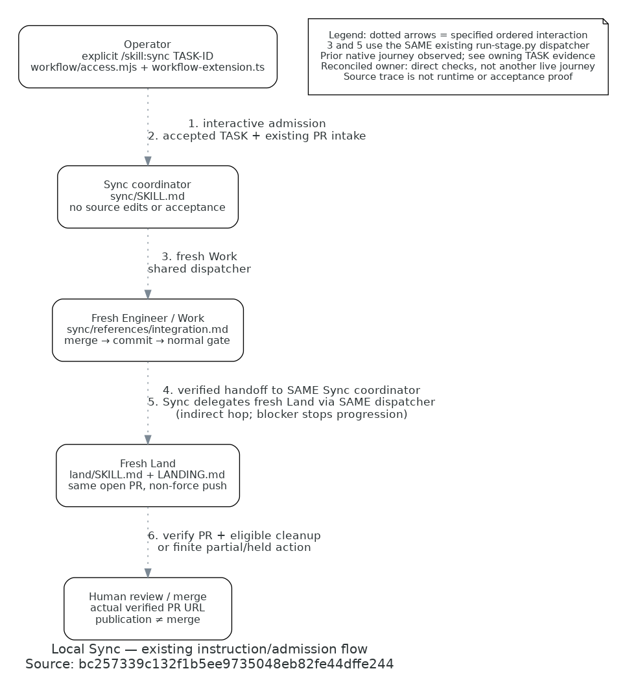

# Local Sync role flow

**Existing instruction/admission flow** at reconciled source
`bc257339c132f1b5ee9735048eb82fe44dffe244`. This view traces the native workflow owner and reuse of existing
process dispatch. The following diagram/documentation changes do not alter those represented sources.

[Editable Python](sync-flow.py). Render with `./bin/diagrams render docs/engineering/sync/sync-flow.py`.
Dotted arrows are specified ordered interactions, not static dependencies or runtime proof. Arrow 4–5 compresses
the return to the SAME Sync coordinator and its next dispatch; Engineer never launches Land. Engineer and Land
are separate fresh contexts. Sync retains coordination and never supplies independent acceptance or source repair.

## Source and arrow trace

All source rows refer to the full implementation revision above; retrieve with `git show REVISION:PATH`.

| Arrow | Source at that revision | Meaning and evidence limit |
|---|---|---|
| 1 | [`WorkflowAccess.input`](../../../harness/pi/src/workflow/access.mjs) and [native extension](../../../harness/pi/src/workflow-extension.ts) | Explicit interactive `sync` selects one TASK, coordination/QA phase and checkout; RPC/extension text cannot select it. Native status is `fight_workflow_status` / `/fight-workflow`, not a file-tool permission gate. Direct SDK checks use simulated input, not operator authority. |
| 2 | [Sync intake](../../../.pi/skills/sync/SKILL.md#admit-one-accepted-subject) | Coordinator checks actual acceptance applicability and exact existing OPEN PR; missing/contradictory evidence holds effects. |
| 3 | [Sync delegation](../../../.pi/skills/sync/SKILL.md#delegate-integration-then-delivery), [provider dispatcher](../../../.pi/skills/build/scripts/run-stage.py) and [owning process monitor](../../../harness/pi/src/observation/run-stage.py) | Fresh Engineer uses existing native package/trust/role/custody machinery with `FIGHT_WORKFLOW_PHASE/TASK/CHECKOUT`. No evaluator preflight, parallel launcher or Build-only SDK substitution. |
| 4 | [Work assignment](../../../.pi/skills/sync/references/integration.md) | Preserve both intents and original reports; commit integration and run normal gate. Concrete incompatible intent, defects, new behavior or failed verification stop advancement. |
| 5 | [Sync progression](../../../.pi/skills/sync/SKILL.md#delegate-integration-then-delivery), [Land](../../../.pi/skills/land/SKILL.md) | Verified integration automatically delegates fresh Land through the SAME dispatcher; no routine Review/QA. This does not remove independent acceptance of Sync's new implementation. |
| 6 | [Advancing-base policy](../LANDING.md#reconcile-an-advancing-base), [delivery verification](../LANDING.md#verify-and-publish) and [resources](../RESOURCE_LIFECYCLE.md) | Land checks scope/evidence, updates only the same PR, verifies exact published head and required evidence, and retires eligible resources. Publication, cleanup holds and human merge remain distinct. |

## Evidence boundary and omissions

[TASK-00587's owning evidence checkpoint](../../../planning/tasks/00587-TASK.md#native-journey-evidence-and-upstream-reconciliation--2026-11-07)
records a genuine operator-selected journey on the original candidate: fresh Engineer, automatic fresh Land,
unchanged original reports, actual integration/gates/same-PR update, source-consumer hold beside successful Docker
teardown and later cleanup-only completion. That input PR has ended merged; it is not another runnable demonstration.
The historical journey predates the native-owner migration. Direct admission/restore/package checks qualify the
reconciled owner, but no second genuine journey or independent acceptance of this reconciled candidate is claimed.
Original source/diagram revision `ff86a39d83c094d6ec501eac0ebd6dddd41d640c` remains retrievable through Git history.

The view omits internal custody, timeout/observation internals, model selection, conflict hunks, application
services and detailed resource guards. The [owning skill](../../../.pi/skills/sync/SKILL.md) and shared standards
retain those contracts. This is trusted local guidance, not a server grant or OS sandbox. Sync itself still needs
normal independent Review and applicable QA; accepted inputs reuse original reports only within the approved
integration-only boundary. The picture is a source trace, not proof of runtime effects or acceptance.
