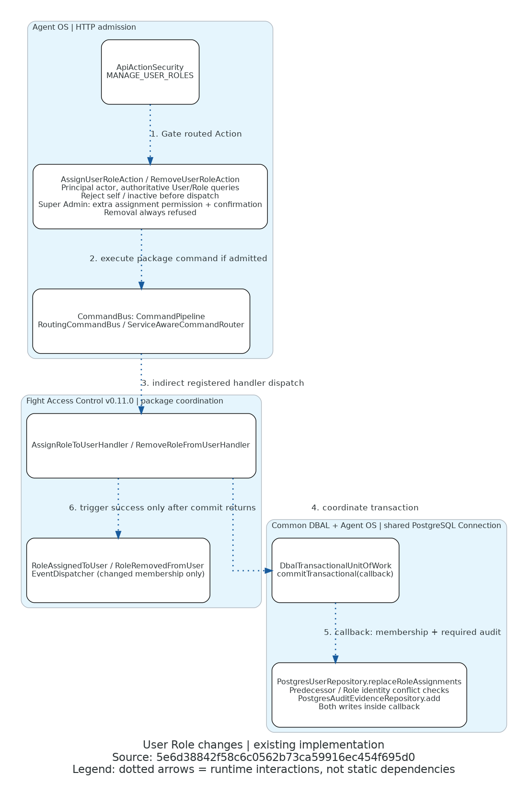

# User Role assignment and removal

This view traces the existing authenticated HTTP association changes, not Role definition mutation.
Implementation source: **5e6d38842f58c6c0562b73ca59916ec454f695d0**.
The documentation-only evidence continuation leaves that implementation unchanged.

[Editable Python](role-change.py) · [Open PNG](role-change.png) ·
[Owning TASK](../../../planning/tasks/00121-TASK.md) · [Architecture contract](../STANDARDS.md#entry-admission-and-authorization-timing)

## Source and arrow traces

All application paths below refer to the full implementation revision above; retrieve them with
`git show 5e6d38842f58c6c0562b73ca59916ec454f695d0:PATH`.
Package sources were also inspected in this checkout's installed vendor tree, selected by
[composer.lock](../../../composer.lock): Access Control v0.11.0,
`6258682512e2c8d76a3fa655dd633167bd8f55b6`; Common v1.5.1,
`c73690164a9f112dbf14d774c56a7c01519b88aa`.

| Arrow | Source and observed meaning |
|---|---|
| 1: HTTP gate → Actions | [ApiActionSecurity::process](../../../src/Adapter/Http/Middleware/Api/Auth/ApiActionSecurity.php) inspects route metadata, authenticates and resolves a request-local principal, checks the declared permissions, then forwards authentication/security attributes. Both Actions declare MANAGE_USER_ROLES. |
| 2: Actions → configured CommandBus | [AssignUserRoleAction::handle](../../../src/Adapter/Http/Action/Api/V1/Users/AssignUserRoleAction.php) and [RemoveUserRoleAction::handle](../../../src/Adapter/Http/Action/Api/V1/Users/RemoveUserRoleAction.php) use principal-only actor identity, safe User/Role query results and exact IDs. Both refuse self and non-active targets before dispatch. Assignment requires ASSIGN_SUPER_ADMIN plus distinct confirmation for the stable managed identity; removal rejects that identity unconditionally. Allowed requests execute AssignRoleToUser or RemoveRoleFromUser, not a direct handler call. |
| 3: bus → package handler (indirect) | [common/command.php](../../../config/common/command.php) binds CommandBus to CommandPipeline over RoutingCommandBus and ServiceAwareCommandRouter, registers assignment and supplies audit. [application/user_roles.php](../../../config/application/user_roles.php) injects the buses, registers removal and explicitly supplies its audit repository. |
| 4: handlers → transaction | Installed `vendor/johnnickell/fight-access-control/src/Application/AccessControl/User/CommandHandler/{AssignRoleToUserHandler,RemoveRoleFromUserHandler}.php`, `handle`, calls commitTransactional. Each callback reloads authoritative User/Role, checks identity/managed consistency and constructs a membership replacement. [Assignment source](https://github.com/johnnickell/fight-access-control/blob/6258682512e2c8d76a3fa655dd633167bd8f55b6/src/Application/AccessControl/User/CommandHandler/AssignRoleToUserHandler.php) · [Removal source](https://github.com/johnnickell/fight-access-control/blob/6258682512e2c8d76a3fa655dd633167bd8f55b6/src/Application/AccessControl/User/CommandHandler/RemoveRoleFromUserHandler.php). |
| 5: transaction callback → membership and audit | The same handlers call replaceRoleAssignments then AuditEvidenceRepository::add within the callback. [PostgresUserRepository::replaceRoleAssignments](../../../src/Adapter/Persistence/AccessControl/User/PostgresUserRepository.php) holds reference fences, locks authoritative roles and conditionally replaces the predecessor. [common/persistence.php](../../../config/common/persistence.php) injects the same shared Connection into User/Role repositories, PostgresAuditEvidenceRepository and DbalTransactionalUnitOfWork. The package audit argument is optional upstream but required by these application factories. |
| 6: handlers → success event after commit | Both installed handlers trigger RoleAssignedToUser/RoleRemovedFromUser only after commitTransactional returns a non-null event. [DbalTransactionalUnitOfWork::commitTransactional](https://github.com/johnnickell/fight-common/blob/c73690164a9f112dbf14d774c56a7c01519b88aa/src/Adapter/Persistence/Doctrine/DbalTransactionalUnitOfWork.php) begins/commits a real transaction and rolls back callback exceptions; nested transactions are refused. |

## Boundaries and limits

Dotted arrows are runtime interactions inferred from inspected source and composition, not static dependency
arrows or a fresh request capture. Step 5 compresses the handler-owned callback: the unit of work executes
that callback, not repository-specific logic. The shared Connection enables atomic membership/audit writes;
there is no consumer transaction decorator and no repeated Application permission/self/state admission.
No-op membership operations validate the Role reference but return no success event or change audit.
Failure notifications and error responses are omitted. Event delivery is not a transactional outbox;
a post-commit listener failure cannot undo a committed membership write, and commit acknowledgement can be uncertain.

The view omits detailed middleware ordering, query routing, response serialization, authentication fences,
bootstrap/invitation callers and event subscribers. It does not prove concurrency scheduling, event delivery,
security, acceptance or deployment. Current-principal refresh is request-local in ApiActionSecurity;
this diagram does not claim an extra explicit cache-invalidation call after mutation.
Independent Review owns artifact assessment and R-02; behavioral QA and publication remain separate.
