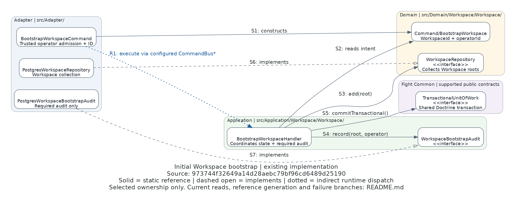

# Initial Workspace bootstrap ownership

**Existing implementation source:** `973744f32649a14d28aebc79bf96cd6489d25190` (TASK-00574).
This remains a historical TASK-00574 ownership view. TASK-00575 changes the bootstrap audit's nullable target
column to `project_id` and the reference input mapper to Project vocabulary; its depicted bootstrap ownership and
coordination edges are unchanged. The original source revision remains the retrieval authority, not today's HEAD. Retrieve evidence with `git show 973744f32649a14d28aebc79bf96cd6489d25190:PATH`.

[Editable Python](bootstrap-ownership.py) · [operational runbook](../REPOSITORY_REGISTRATION.md)

## Question and scope

Who owns initial Workspace creation, persistence and required audit after extraction from the registration Store?
This is a selected class/layer ownership view, **not** a complete dependency graph or runtime sequence diagram.
The legend is visible in the image: solid directed arrows are static references, dashed open arrows implement a
port, and the dotted arrow is indirect runtime dispatch through the configured CommandBus. Boxes use source names;
Domain `Command/BootstrapWorkspace` is distinct from Adapter `BootstrapWorkspaceCommand`.

## Source and arrow traces

Every source below is inspected at the full revision above. Links resolve in this checkout; the revision is the
immutable retrieval authority, not an inference that all later changes conform.

| Trace | Source | Meaning |
|---|---|---|
| S1 | [BootstrapWorkspaceCommand](../../../src/Adapter/Console/BootstrapWorkspaceCommand.php), `execute()` | Validates explicit internal/operator confirmation, generates `WorkspaceId`, constructs the Domain command before dispatch |
| S2 | [BootstrapWorkspaceHandler](../../../src/Application/Workspace/Workspace/CommandHandler/BootstrapWorkspaceHandler.php), `handle()` | Checks the message type and uses its supplied identity/operator; no transport admission inside the handler |
| S3 | Same handler; [WorkspaceRepository](../../../src/Domain/Workspace/Workspace/WorkspaceRepository.php), `add()` | Adds the [Workspace root](../../../src/Domain/Workspace/Workspace/Workspace.php), which holds [WorkspaceId](../../../src/Domain/Workspace/Workspace/WorkspaceId.php) and creation time |
| S4 | Same handler; [WorkspaceBootstrapAudit](../../../src/Application/Workspace/Workspace/WorkspaceBootstrapAudit.php), `record()` | Required audit is an explicit handler collaborator, not inferred from a callback return or replay row |
| S5 | Same handler; installed `Fight\Common\Application\Repository\TransactionalUnitOfWork` | One generic transaction encloses state then audit; [shared persistence binding](../../../config/common/persistence.php) supplies the qualified Doctrine implementation and shared connection |
| S6 | [PostgresWorkspaceRepository](../../../src/Adapter/Persistence/Workspace/Workspace/PostgresWorkspaceRepository.php) | Implements the collection port; never commits/flushes, owns initial-slot constraint translation and aggregate hydration |
| S7 | [PostgresWorkspaceBootstrapAudit](../../../src/Adapter/Persistence/Workspace/Workspace/PostgresWorkspaceBootstrapAudit.php) | Implements required audit on the same injected connection, without creating an original-response snapshot |
| R1 | Console `execute()` → configured bus → handler; [workspace module](../../../config/application/workspace.php), [command pipeline/router](../../../config/common/command.php) | Indirect `CommandBus::execute()` dispatch, not a direct Console-to-handler dependency; registration alone does not authorize execution |

## Current reads and technical references outside the picture

Console first dispatches `FindInitialWorkspace`. Existing state is returned without another create or audit; absent
state permits explicit creation. After successful dispatch it queries `GetWorkspaceById` for the known identity's
current creation time. Both registered handlers use the Workspace repository and project an Application
`WorkspaceView`; optional absence and required `ResourceNotFound` are deliberate. Lookup failures propagate rather
than becoming absence. [Workspace composition](../../../config/application/workspace.php) and the
[query pipeline](../../../config/common/query.php) own those registrations.

The [reference Action](../../../src/Adapter/Http/Action/Api/V1/References/GenerateExceptionalReferenceAction.php)
receives central current authentication/independent permission admission, then checks current initial Workspace
scope and managed administrator identity/membership. It invokes
[ExceptionalReferences](../../../src/Adapter/Reference/ExceptionalReferences.php): a short technical transaction
serializes only bounded actor/window/attempt metadata, then Common's `Uuid::comb()` generates a non-reserved UUID.
The [Responder](../../../src/Adapter/Http/Responder/Api/V1/References/GenerateExceptionalReferenceResponder.php)
owns safe HTTP representation. There is no reference business command/aggregate, Application forwarder, access grant,
import authority or generated-ID persistence. [Composition](../../../config/application/exceptional_references.php)
keeps this technical owner separate from Project command/query composition.

## Omitted flow and limitations

- The picture omits current-read handlers/Views, root/ID nodes, clocks, Symfony parsing, bus/filter internals,
  Doctrine/DBAL internals, schema and reference-generation classes. The tables/prose above cover only named edges.
- State and audit commit together. Required audit failure rolls state back; a presentation/lookup failure after
  commit is uncertain, not rollback. Competing initial-slot commands can conflict; a subsequent explicit invocation
  reads current state, never an immutable replay response. No success event is invented for symmetry.
- The preserved database invariant, independent audit migration and historical facts are described in the current
  runbook. TASK-00575 replaces the former registration Store/replay/admission paths; Workspace remains separate.
- Static source tracing establishes these references/bindings, not measured execution, correctness, security,
  concurrency safety, independent acceptance, production deployment or future supplier compatibility. Actual
  behavioral evidence and warnings belong in TASK-00574 and its ignored Engineer handoff.
